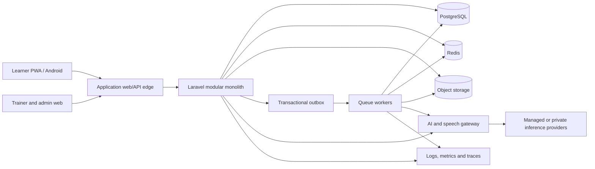

# Global English — Enterprise Product and Implementation Master Plan

## Quick navigation

- **Product:** [Executive decision](#1-executive-decision), [learning system](#4-learning-system), [dialects/localization](#5-kannada-dialects-code-switching-and-localization), [curriculum](#6-curriculum-and-content-model), [learner experience](#7-learner-experience) and [Phase 1 scope](#9-phase-1-scope).
- **Engineering:** [architecture principles](#10-architecture-principles), [technology](#11-technology-baseline), [module boundaries](#13-modular-monolith-boundaries), [voice/AI architecture](#14-voice-and-ai-architecture), [API rules](#15-api-and-consistency-rules), [domain model](#16-target-domain-model), [offline](#17-offline-and-low-bandwidth-contract) and [privacy/security](#18-privacy-security-and-responsible-ai).
- **Delivery:** [quality/evaluation](#21-quality-and-evaluation-strategy), [release gates](#22-validation-and-release-gates), [delivery plan](#23-delivery-plan), [effort/team](#24-manual-effort-and-team), [Codex contract](#25-codex-agent-operating-contract), [PR sequence](#26-initial-implementation-backlog-and-pull-request-sequence) and [definition of done](#27-phase-1-definition-of-done).
- **Start:** [accepted defaults](#32-decisions-accepted-by-default) and [first Codex prompt](#33-first-codex-task-prompt).

## 0. Document authority and working rules

This document is the single product, architecture and delivery baseline for the Global English repository.

It consolidates the voice-first product direction of the revised high-level plan with the tenancy, curriculum governance, deterministic learning records, security, accessibility, reliability and release discipline of the enterprise master plan.

### 0.1 Precedence

When repository artefacts conflict, use this order:

1. this master plan;
2. an accepted Architecture Decision Record in `docs/adr/` that explicitly amends this plan;
3. an approved feature specification in `docs/specs/`;
4. the active issue or task;
5. existing implementation behaviour.

Code, comments, tests and old documents do not silently override this plan. A material change requires an ADR, an impact note and an update to this file.

### 0.2 Development method

Development proceeds through small, testable vertical slices. Do not create the entire target schema or every screen before completing the first end-to-end learner journey.

Each checkpoint must deliver:

- a usable increment;
- automated tests appropriate to the risk;
- updated API and data contracts;
- observability for the new path;
- documentation of decisions and known limitations;
- a demonstrated exit gate before the next checkpoint begins.

### 0.3 Product rule

Global English is **voice-first and AI-enhanced**, but authoritative learning records remain deterministic.

- AI conversation is a primary product capability.
- AI does not decide marks, attendance, mastery, entitlements or level unlocks.
- A downloaded deterministic learning path remains usable when AI is unavailable.
- AI feedback is advisory until validated against bilingual human review.

---

## 1. Executive decision

Build a mobile-first, Kannada-guided spoken-English platform for adults who need practical English for daily life, education, interviews, customer interactions and work.

The first production release will provide:

- a responsive Progressive Web App optimized for low-cost Android phones and unreliable networks;
- a Google Play Android application using the same React learner experience in a Capacitor native runtime;
- a web operator console for content reviewers, trainers and organization administrators;
- a structured AI Tutor that explains English from the basics in Kannada;
- a persistent, user-controlled AI Friend for natural conversation;
- a Role-play Studio for realistic situations;
- grammar correction, natural-English suggestions, retry and Kannada explanation;
- versioned curriculum, governed bilingual content and auditable learning evidence;
- organization-aware identity, cohorts and permissions without broad LMS complexity;
- offline deterministic lessons and reliable reconnect synchronization;
- provider-neutral speech and AI integration, with a later path to open-weight or on-prem deployment.

The product promise is:

> Open the app, understand the task in Kannada, speak useful English within minutes, receive a clear correction without losing the conversation, and always know the next small step.

### 1.1 Canonical Phase 1 baseline

| Decision | Baseline |
|---|---|
| Initial learner | Kannada-speaking adults aged 18 or older |
| Primary experience | Structured Tutor + AI Friend + Role-play Studio |
| Learning language | English |
| Explanation and default UI | Kannada explanation and `kn-IN` default UI; Phase 1 UI-only preview catalogues for `ml-IN`, `ta-IN`, `te-IN` and `hi-IN`; `en-IN` source/fallback |
| Delivery | Mobile-first PWA, Capacitor Android app, web operator console |
| Architecture | Laravel modular monolith with external AI/speech adapters |
| Authentication | One platform-global username/password sign-in and the same verified-contact setup/recovery lifecycle for every role; roles and permission groups authorize work after sign-in; invitations/admission workflows authorize enrollment but not ongoing sign-in; Sanctum same-origin cookies for web/PWA; Passport Authorization Code with PKCE for Android; current-password confirmation is limited to credential changes, recovery-contact management and administrator-authority changes |
| Authoritative records | Deterministic, versioned, explainable and auditable |
| AI authority | Advisory only; never writes marks, mastery, attendance or unlocks |
| Offline | Downloaded deterministic mission, recording/playback and queued progress; no offline AI in Phase 1 |
| Pilot content | One complete foundation pathway of up to 20 reviewed modules |
| Pilot tenancy | Platform-owned Global English Direct organization; at most one manually provisioned partner institution; no self-service tenant sales |
| Pilot learners | 40–100 representative beta learners; capacity-tested for a larger production pilot |
| Validation Beta | Approximately 1,500–1,850 professional hours; 10–14 weeks with a blended team |
| Full Phase 1 base | Approximately 3,850 professional hours |
| Controlled reserve | Approximately 580 hours |
| Planning ceiling | 4,430 hours mathematically; rounded commercial authorization ceiling of 4,450 hours |
| Indicative full programme | Approximately 24–30 delivery weeks with a suitable blended team and timely content approvals |

Hours are cumulative human professional effort, not AI processing time and not a guarantee of calendar duration. Codex may accelerate implementation, testing and documentation, but accountable humans remain responsible for architecture, security, privacy, academic quality, Kannada review, model evaluation, device testing and release decisions.

---

## 2. Consolidation decisions and resolved conflicts

| Conflict between the source plans | Canonical resolution |
|---|---|
| Bounded AI Teacher versus voice-first conversational product | Voice conversation is core through Tutor, Friend and Role-play modes. AI remains bounded by scenario, objective, safety policy and structured output. |
| PWA-only enterprise baseline versus Android launch | Build the PWA first and package the approved learner experience with Capacitor 8 for Google Play. Do not build a separate Kotlin or Flutter product in Phase 1. |
| Enterprise administration versus focused learning MVP | Include tenancy, identity, enrollment, content governance, trainer review and reporting. Defer broad attendance, notice-board and LMS functions unless a signed pilot requires them. |
| Nineteen named levels versus a 20-module pilot | Model levels generically. Seed and publish only one complete foundation pathway. Do not hard-code a nineteen-level count in application logic. |
| AI as optional enhancement versus AI as the product differentiator | AI conversation is a principal online experience; deterministic lessons, scoring and progression are independent fallback capabilities. |
| Live conversation ambiguity | Phase 1 uses low-latency, turn-based voice interaction. Full-duplex telephony, simultaneous overlapping speech and WebRTC conversation are excluded. |
| One provider or local-model assumption | Use stable project-owned provider ports and adapters. Select initial providers through a benchmark; support open-weight and on-prem inference later without changing domain code. |
| AI correction mixed into every reply | Produce a natural conversational reply and a separate learning-feedback object. Show corrections according to the learner’s selected coaching mode. |
| Dialect detection as a product feature | Do not label a learner’s dialect. Evaluate meaning capture, correction quality and subgroup gaps across representative Karnataka speech patterns. |
| Hard-coded Kannada text | Govern `kn-IN` UI and learning content through source-linked revisions, bilingual review, approval, publication and rollback. |
| Broad learner memory | Store only explicit, purpose-bound and user-visible memory facts. Raw conversation does not automatically become persistent memory. |
| Draft DPDP reference | Use the final Digital Personal Data Protection Rules, 2025 notification and its phased commencement; obtain legal review before production. |
| Version ambiguity | Start with Laravel 13.x, PHP 8.4.x, React 19.2.x, Node.js 24 LTS, Capacitor 8.x and PostgreSQL 18.x, pinning exact patch versions in lockfiles during scaffolding. |
| Estimate arithmetic | `3,850 + 580 = 4,430`; retain 4,450 only as a rounded authorization ceiling, not as a mathematical subtotal. |

---

## 3. Product strategy

### 3.1 Initial learner profiles

Research, onboarding and testing must represent at least four profiles:

1. **Pre-A1 beginner:** limited English vocabulary or literacy and high dependence on Kannada guidance.
2. **Hesitant school-English learner:** understands familiar English but avoids speaking because of fear or embarrassment.
3. **Opportunity learner:** needs English for placement, interview, service, travel or workplace situations.
4. **Low-connectivity/shared-device learner:** may have unreliable data, limited privacy for recording or intermittent device access.

The platform must not infer English ability, Kannada literacy, digital confidence or goals only from location, accent or language preference.

### 3.2 Primary outcomes

The platform succeeds when learners can:

- understand level-appropriate spoken English in a practical situation;
- produce comprehensible phrases and short turns;
- ask and answer follow-up questions;
- clarify, repair and continue a conversation;
- use corrected language in a retry;
- retain useful language after a delay;
- transfer a practised pattern to a new situation;
- speak with greater confidence without being shamed for mistakes or accent.

### 3.3 North-star metric

**Weekly learners who complete at least three meaningful speaking-practice sessions and one delayed review.**

A meaningful speaking-practice session contains learner speech, an understandable response or task outcome, and feedback or reflection. Opening a page, playing audio or answering only multiple-choice questions does not qualify.

### 3.4 Product and learning metrics

Learning metrics:

- observable “I can…” objectives mastered;
- meaningful speaking turns and speaking minutes;
- first-attempt versus retry improvement;
- delayed-review performance;
- task completion in a novel role-play;
- recurring-error reduction;
- human-rated comprehensibility, interaction and transfer.

Product metrics:

- first-session speaking activation;
- day-7 and day-30 retained learners;
- sessions per active learner;
- completion by Tutor, Friend and Role-play mode;
- time to first useful speaking action;
- offline completion and successful sync;
- learner-reported clarity of Kannada guidance;
- return rate to the persistent AI Friend.

Guardrail metrics:

- cross-tenant access incidents;
- lost or duplicate attempts;
- AI critical-safety or privacy failures;
- false or unhelpful correction rate;
- subgroup recognition gaps;
- accessibility blockers;
- support cases per 100 active learners;
- AI, speech, storage and media cost per active learner.

Commercial-discovery metrics:

- cost per completed speaking session and projected monthly active learner;
- willingness to pay at tested monthly and annual price points;
- direct-learner trial-to-paid intent or conversion in an approved controlled experiment;
- institution interest, likely seat volume and per-seat economics;
- support and content-review effort per 100 active learners.

Phase 1 does not require in-app billing to measure these hypotheses; research, pilot offers and externally administered experiments may be used with appropriate consent and disclosure.

### 3.5 Claims the product will not make

Phase 1 will not promise:

- general fluency within four weeks;
- accent elimination or native-accent imitation;
- guaranteed employment, academic or interview outcomes;
- formal CEFR certification or equivalence;
- perfect recognition of every Kannada dialect or mixed-language utterance;
- authoritative automated pronunciation grading;
- replacement of qualified teachers in all learning situations.

---

## 4. Learning system

### 4.1 The three learner modes

#### A. Structured Tutor

The Tutor provides a progressive learning path from the basics. It can:

- introduce a concept in concise conversational Kannada;
- demonstrate the English pattern and meaning;
- play model words, phrases and sentences;
- ask the learner to repeat, transform or create a sentence;
- correct the priority error;
- explain the correction in Kannada;
- request a retry;
- move the same skill into a short conversation;
- schedule review from actual learner evidence.

Example:

> **Tutor:** ಇಂದು ನಾವು Past Tense ಕಲಿಯೋಣ. ಈಗಾಗಲೇ ನಡೆದ ಕೆಲಸವನ್ನು ಹೇಳುವಾಗ past tense ಬಳಸುತ್ತೇವೆ.  
> **Tutor:** “I go to the office” is present. “I went to the office” is past.  
> **Tutor:** What did you do yesterday?

#### B. AI Friend

The Friend behaves as a normal, patient conversational partner. It can discuss work, home, family, hobbies, food, travel and everyday experiences.

The Friend must:

- respond to the meaning of the learner’s turn before presenting correction;
- ask relevant, natural follow-up questions;
- use vocabulary and speaking speed appropriate to the learner;
- correct only the most useful issue by default;
- offer a more natural expression when beneficial;
- avoid sarcasm, ridicule, shame and unnecessary academic jargon;
- remember only approved, user-visible facts;
- clearly disclose that it is an AI character.

#### C. Role-play Studio

The learner chooses a setting, role, difficulty and coaching style. The AI plays the other character and pursues a defined scenario goal.

Representative scenarios:

- coffee-shop conversation;
- job interview;
- office introduction or daily stand-up;
- customer or vendor meeting;
- bank visit;
- hotel or restaurant;
- airport, taxi, bus or railway interaction;
- clinic receptionist;
- sales prospect;
- presentation audience;
- telephone support call.

Role-play stages:

1. **Observe:** listen to a short model dialogue.
2. **Rehearse:** take one role with hints and suggested chunks.
3. **Perform:** complete an open-ended exchange.
4. **Reflect:** review task completion, priority corrections, stronger vocabulary and a retry task.

### 4.2 All-levels four-session path

Every configured level uses the same learner-facing sessions, accepted under
ADR-0025 / APP-0061:

1. **Introduction** — play the exact governed Introduction audio; the
   Structured Tutor explains it in Kannada; complete short speak-heavy
   activities that notice the target pattern.
2. **Practice** — rehearse with the Practice audio and authored activities;
   complete deterministic Check items when authored.
3. **Conversation** — open a free-speech, lesson-scoped Skill Chat on
   level-appropriate topics (not a fixed script); meaning-first reply with a
   separate coaching object.
4. **Interaction** — freer Friend or light Role-play Apply speech still
   bounded by level safety and topic policy.

Session kinds are data-driven. Domain code must not hard-code Level 1–17,
four lessons, or a single concept such as `can`. Levels without commissioned
media remain visible as commissioning-pending shells. Review remains a
deterministic delayed return rather than a fifth first-run room.

These sessions map onto Learn → Talk → Check → Apply → Review without making
AI authoritative for marks, mastery or unlocks.

### 4.3 Standard daily mission

A normal mission should take approximately 10–15 minutes:

1. Kannada goal and context.
2. Short English model dialogue.
3. Listen once for meaning and again for detail.
4. Notice three to five useful English chunks or one pronunciation feature.
5. Repeat, record, play back and retry.
6. Guided sentence formation or substitution.
7. Three-to-five-turn role-play or personal response.
8. Prioritized correction and concise Kannada explanation.
9. Retry using the improved sentence.
10. Short recall check and next action.
11. Delayed review scheduled from objective and error evidence.

Every core mission contains learner speech. When a microphone is unavailable, the learner receives a transparent alternative path but is not awarded spoken mastery without spoken evidence.

### 4.4 Correction model

The system distinguishes:

- **meaning failure:** the listener cannot reliably understand the intended meaning;
- **major grammar error:** tense, agreement, word order, question form or a missing essential word;
- **naturalness improvement:** understandable English that can be expressed more naturally;
- **vocabulary improvement:** a more precise or context-appropriate word or phrase;
- **pronunciation coaching:** a word or sound may be unclear while grammar is acceptable;
- **style or register:** politeness, formality, confidence or concision.

Coaching modes:

| Mode | Behaviour |
|---|---|
| Gentle Friend | Continue naturally and show at most one priority correction after the turn |
| Tutor | Explain important errors, request a retry and provide guided practice |
| Fluency | Do not interrupt; summarize feedback after the conversation |
| Interview | Conduct the interview first; issue a structured report afterward |

A correction object should contain:

- what the system understood;
- the learner transcript;
- corrected English;
- one natural alternative when useful;
- a short Kannada explanation;
- whether a retry is recommended or required;
- optional model pronunciation audio;
- error category and objective link for review scheduling.

The system must not correct a legitimate Indian English form merely because it differs from one native-speaker preference. Prioritize comprehensibility, task success and broadly useful professional English.

### 4.5 Kannada-guided grammar teaching

Kannada explanations are contrastive, practical and short. Grammar is taught through repeated speaking rather than long lectures.

| Concept | Kannada-guided explanation | English examples |
|---|---|---|
| Present simple | ಪ್ರತಿದಿನ, ಸಾಮಾನ್ಯವಾಗಿ ಅಥವಾ ನಿಯಮಿತವಾಗಿ ಮಾಡುವ ಕೆಲಸ | I work in Mangaluru. I drink coffee every morning. |
| Present continuous | ಈಗ ನಡೆಯುತ್ತಿರುವ ಕೆಲಸ | I am speaking to a customer now. |
| Past simple | ಈಗಾಗಲೇ ನಡೆದ ಕೆಲಸ | I went to the office. I met a customer. |
| Future | ಮುಂದೆ ಮಾಡುವ ಯೋಜನೆ ಅಥವಾ ನಿರ್ಧಾರ | I will call you tomorrow. I am going to travel next week. |
| Articles | ಒಬ್ಬ/ಒಂದು ಸಾಮಾನ್ಯ ವ್ಯಕ್ತಿ ಅಥವಾ ವಸ್ತುವಿಗೆ `a/an`; ನಿರ್ದಿಷ್ಟದಕ್ಕೆ `the` | I met a customer. The customer called again. |
| Questions | ಪ್ರಶ್ನೆಯಲ್ಲಿ ಸಹಾಯಕ ಕ್ರಿಯಾಪದದ ಸ್ಥಾನ ಬದಲಾಗುತ್ತದೆ | Do you work here? Did you call him? |

Maintain an educator-reviewed contrastive error bank. Trigger guidance from a learner’s actual evidence, not from stereotypes about Kannada speakers.

### 4.6 Pronunciation and fluency

Phase 1 provides non-authoritative coaching through:

- learner recording playback;
- model-word and model-sentence audio;
- slower playback and chunk practice;
- recognition-confidence and mismatch signals;
- speaking rate, pause and repetition observations;
- human-reviewed pilot evaluation.

Pronunciation signals do not control marks, mastery or access in Phase 1. The product must not penalize a legitimate accent merely for differing from a native accent.

### 4.7 Assessment and mastery

Separate practice from formal checks:

- formative practice allows guided retries and records first, latest and best evidence;
- summative checks use bounded attempts and a new situation;
- delayed reviews test retention after an interval;
- trainer review is available for flagged or borderline attempts;
- automated speech analysis remains advisory until validated against trained human raters.

The speaking rubric covers:

- task completion;
- comprehensibility and intelligibility;
- fluency and pausing;
- useful vocabulary and chunks;
- grammar control appropriate to the objective;
- interaction, turn-taking, clarification and repair.

Mastery and level unlocking are deterministic, versioned, explainable and auditable. An LLM may explain a result but may not create or modify the authoritative result.

### 4.8 Learner memory

The learner profile may retain:

- current goal;
- preferred topics;
- known objectives and vocabulary;
- recurring high-priority errors;
- completed role-plays;
- review-due items;
- speaking activity and consistency;
- user-approved personal facts for the AI Friend.

Memory controls:

- the learner can view, edit and delete remembered facts;
- each fact records its purpose, source and visibility;
- sensitive facts are not retained merely because they appeared in conversation;
- raw audio is never used to train a model without separate explicit consent;
- clearing AI memory does not silently delete required account or legal records;
- automatic memory candidates must be confirmed by policy or by the learner before persistence.

---

## 5. Kannada, dialects, code-switching and localization

### 5.1 Phase 1 expectations

The system should support, within measured limits:

- standard Kannada;
- natural Kannada-English code-switching;
- English spoken with common Karnataka accents;
- Kannada script and mixed-script text where supported;
- learner correction of an inaccurate transcript.

### 5.2 Dialect strategy

Do not attempt to identify or label the learner’s dialect in Phase 1. Build an evaluation set containing consented, anonymized samples representing:

- Bengaluru/Mysuru speech patterns;
- Coastal Karnataka speech patterns;
- Malenadu speech patterns;
- North Karnataka speech patterns;
- Kannada-English code-switching;
- speakers influenced by Tulu, Konkani, Beary or other local languages;
- representative device microphones and background-noise conditions.

Measure:

- transcription accuracy where a reference transcript exists;
- intended meaning captured;
- correction precision and false-correction rate;
- Kannada explanation usefulness;
- response latency;
- subgroup performance gaps.

### 5.3 Recognition recovery

The learner can:

- view and edit the transcript;
- select “That is not what I said”;
- replay and re-record;
- switch input language;
- use Kannada text as a fallback;
- report repeated recognition failure.

A transcript correction must remain linked to the original recognition result for evaluation, while the edited text becomes the learner-approved input for the next step.

### 5.4 Localization governance

Use BCP 47 locale codes:

- default UI and explanation: `kn-IN`;
- additional Phase 1 UI-only previews: `ml-IN`, `ta-IN`, `te-IN` and
  `hi-IN`;
- learning language: `en-IN`;
- optional operator UI: `en-IN`.

Store separate preferences for:

- `ui_locale`;
- `explanation_locale`;
- `learning_locale`;
- instruction-audio preference;
- transliteration preference;
- speaking-speed preference;
- accessibility preferences.

Rules:

- UI messages and curriculum content have separate lifecycles;
- learner-critical content cannot publish without approved Kannada;
- every localized variant links to source revision/hash, translator, reviewer and approval time;
- source edits mark dependent translations stale;
- a translator cannot approve the same translation;
- the glossary defines preferred plain-language Kannada and stable product terms;
- mixed-language spans use correct `lang` metadata;
- fallback is explicit and observable, never silent;
- transliteration is optional and is never the pronunciation authority.

Under ADR-0005, the additional Phase 1 locales apply only to application UI
messages. They do not expand curriculum localization, Kannada explanation
requirements, speech recognition, model audio or AI explanations. Every
translated UI catalogue remains a draft until its exact revision and hash
receive independent human language review. Production falls back visibly to
English until that approval exists.

---

## 6. Curriculum and content model

### 6.1 Generic curriculum architecture

The application supports arbitrary programs, curriculum versions, levels, modules, objectives, prerequisites and review rules. It must not hard-code Pre-Level 1, Pre-Level 2 or Levels 1–17 into domain logic.

If the business retains those public labels, they are content configuration.

Every published level requires:

- four to eight observable adult-life “I can…” outcomes;
- target situations and communication functions;
- listening, spoken-production and interaction evidence;
- vocabulary and useful chunks;
- grammar in use;
- pronunciation/intelligibility focus;
- prerequisites;
- estimated learning time;
- formative practice;
- a transfer task;
- remediation and delayed-review rules.

The outcome framework may be informed by CEFR Pre-A1, A1, A2 and B1 descriptors. Do not claim official CEFR certification or equivalence without independent validation.

### 6.2 Phase 1 foundation pathway

Phase 1 integrates up to 20 reviewed modules into one foundation pathway.

#### Foundations — 8 modules

1. Greetings and introductions.
2. `be`, `have` and personal information.
3. Present simple and daily routines.
4. Present continuous and what is happening now.
5. Past simple and talking about yesterday.
6. Future plans using `will` and `going to`.
7. Questions, negatives and short answers.
8. Articles, common prepositions and frequent transfer errors.

#### Daily life — 6 modules

9. Family and home.
10. Coffee-shop conversation and small talk.
11. Shopping and restaurant communication.
12. Travel, taxi, bus, railway and directions.
13. Appointments, clinic and service conversations.
14. Telephone calls and asking for help.

#### Work and opportunity — 6 modules

15. “Tell me about yourself” for an interview.
16. Office introductions and daily stand-up.
17. Customer meeting and requirement discussion.
18. Sales, pricing and negotiation.
19. Presentation, clarification and problem-solving.
20. Free-conversation capstone and personalized review.

The exact order may change after learner research, but the software model and estimate assume no more than 20 integrated pilot modules.

### 6.3 Learning bundle requirements

Every module package contains:

- versioned objective and prerequisite mapping;
- Kannada goal and explanation;
- English model dialogue;
- transcript and accessible audio masters;
- useful phrases and grammar focus;
- guided practice;
- speaking task;
- role-play configuration;
- expected correction patterns;
- questions, answers and rationale;
- review schedule;
- safety notes where needed;
- content, voice and media rights metadata.

### 6.4 Content workflow

A bundle moves through:

`Draft → Linguistic review → Academic approval → Scheduled → Published → Retired`

The content studio supports:

- objective and prerequisite selection;
- source-English content;
- Kannada explanation and audio;
- transcript and accessibility validation;
- model dialogue and speaking task;
- assessment rationale;
- low-data media variants;
- phone-width preview;
- translator and independent reviewer attribution;
- scheduling by curriculum/cohort;
- immutable publication versions;
- rollback to a prior published version.

Raw machine-translated or unreviewed Kannada cannot be published.

### 6.5 Content-production boundary

The software estimate includes platform configuration and integration of up to 20 client-approved modules.

If the delivery team must research, author, adapt, record, review and validate the complete package, allow an additional **550–850 specialist hours** for learning design, English academic review, Kannada review and audio production. This is not software coding.

---

## 7. Learner experience

### 7.1 Mobile navigation

Use five primary destinations, with 1:1 last:

- **Home** — today’s recommended lesson journey
- **Learn** — the four-session level path (Introduction → Practice → Conversation → Interaction)
- **Speak** — one speaking room (everyday talk with Swathi and a situation picker)
- **Progress**
- **1:1** — waitlist request plus institute contact links; not an in-app call, booking or payment

Account, privacy, downloads, help and settings are available through the profile/menu area. Backend module boundaries must not become learner navigation.

### 7.2 Home

Home has one dominant action, resolved deterministically:

- a **due delayed review** when one exists; otherwise today’s recommended practice;
- mode and estimated time;
- download size when relevant;
- current progress such as “1 of 3 steps complete”;
- one large Continue button;
- connection, offline and sync state;
- one urgent support or service message when necessary.

Home also shows a **meaningful-speaking-day streak** as secondary chrome. A day
counts only when it contains learner speech and a recorded response or task
outcome, matching the §3.3 north-star definition; application opens, lesson-audio
playback and multiple-choice-only sessions never count. The streak is derived,
advisory and never gates content. There is no attendance percentage in canonical
learning records, and no streak freeze, repair or purchase in Phase 1. See
[ADR-0028](docs/adr/0028-meaningful-speaking-streak-and-delayed-review.md).

Authentication before Home is one platform-global username/password surface
for every role. Organization, role, cohort, program, level and tier are
resolved only after sign-in. Every role uses the same enumeration-safe,
verified-contact password setup/recovery path under ADR-0022; a privileged
role never selects a different login or recovery product.

### 7.3 Core screens

| Screen | Required experience |
|---|---|
| Sign in | Every learner and operator uses a platform-global username and password. Institutional invite/code or admission workflows establish enrollment before one-time credential setup; they are not continuing sign-in factors. Kannada-first recovery |
| First use | Adult confirmation, language/accessibility preferences, audio-led walkthrough, goal selection, short placement, recording and AI consent |
| Home | One recommended action, sync state, review due and concise progress |
| Tutor | Kannada concept, model English, audio, guided speaking, correction, retry and next step |
| Friend | AI disclosure, topic, difficulty, coaching mode, user-controlled memory and natural conversation |
| Role-play | Scenario, role, goal, hints, conversation, completion state and reflection |
| Speaking turn | Clear listening/recording state, cancel, playback, retry, transcript review and permission explanation |
| Correction | Understood meaning, learner sentence, corrected sentence, natural alternative, Kannada explanation and retry |
| Lesson | Large audio controls, replay, 0.75×/1× speed, transcript, Kannada help, download size and resume position |
| Quiz/check | One question per screen, large targets, autosave and no forced timer |
| Result | Can-do feedback, evidence, priority improvement, retry and next action |
| Progress | Objectives, speaking activity, review due, recurring errors and recent improvement |
| Memory & privacy | View/edit/delete AI memory, recordings, consent and account-deletion controls |
| Help & sync | Unsynced count, retry, Kannada explanation, support reference and contact route |

### 7.4 Conversation-state UX

The learner must always know whether the system is:

- listening;
- processing speech;
- preparing a response;
- speaking;
- waiting for the learner;
- offline;
- retrying;
- using a text-only fallback.

The learner can stop AI playback. Barge-in during generated audio may be added after device validation, but simultaneous full-duplex conversation is not required.

---

## 8. Enterprise and operator experience

### 8.1 Enterprise principle

Enterprise-ready means that institutions can safely enroll, support and evaluate learners without direct database access. It does not mean building a broad LMS before proving the voice product.

Tenancy is an internal security boundary, not mandatory learner-facing friction. Direct consumer learners are assigned automatically to the platform-owned **Global English Direct** organization and do not enter an organization code. Institutional learners join an institution through an invite/code or administrator-created enrollment. Cohort membership is optional for direct learners.

### 8.2 Minimum Phase 1 operator console

#### Trainer/reviewer workspace

- organization/cohort learner overview;
- first-session activation and recent completion;
- learners needing help;
- failed sync and repeated recognition problems;
- consent-permitted sampled speaking/correction review;
- selected speaking submissions awaiting human feedback;
- learner history and support notes;
- permission-controlled CSV export.

#### Content studio

- program, objective, module and lesson editing;
- Kannada review and glossary;
- media and rights metadata;
- publication workflow;
- scenario and persona configuration;
- prompt/model/configuration version visibility;
- rollback and audit history.

#### Organization administration

- organization, branch and cohort configuration where required;
- enrollment and trainer assignment;
- organization-scoped roles and permissions;
- session revocation and organization-scoped account support; global recovery
  contact replacement remains restricted to the explicit
  `platform.account_recovery.manage` capability and is never granted by an
  organization role;
- timezone and feature settings;
- audit, retention, export and deletion workflows.

### 8.3 Optional institution-operations pack

The following are deliberately outside the voice-product critical path and require a separate approved package unless the signed pilot depends on them:

- trainer-recorded class attendance;
- attendance correction and academic calendars;
- institution notice board and acknowledgements;
- advanced cohort scheduling;
- extended institutional reports;
- self-service institution provisioning and billing.

The core data model must not confuse learning engagement with attendance, even if attendance is introduced later.

#### Approved operator-parity expansion

DR-0014 Option A and ADR-0014 approve a separate, staged operator-parity
expansion after the ordered PRIV-DSR-01, REL-01 and MAINT-01 remediation
checkpoints. The approved expansion may add:

- admin-managed plan catalogues and deterministic manual or externally
  reconciled entitlements with immutable grant, adjustment and revocation
  evidence;
- moderated notices and explicitly typed organization groups, subject to
  purpose, audience, retention, reporting, blocking and deletion policies
  fixed before the affected implementation;
- assignment and workshop submissions with rubric-based human review,
  correction history and learner-visible feedback;
- timezone-aware facilitated-session scheduling with validated external
  meeting links, without an in-product conferencing or recording service; and
- separate in-app post and public editorial-CMS workflows with governed
  revisions, publication authority, accessibility and media rights.

These capabilities are optional operations, not Phase 1 voice-product
prerequisites. Their exact functional inventory, checkpoint order and retained
decision gates are defined by
[the approved reference-admin parity specification](docs/ADMIN_REFERENCE_PARITY_PLAN.md).
Approval of the program does not claim implementation, checkpoint acceptance,
production data migration, deployment or production release.

---

## 9. Phase 1 scope

### 9.1 Must ship

- organization-aware identity, memberships, roles, cohorts and enrollments;
- adult onboarding, preferences, placement and explicit consent;
- Kannada-first accessible learner shell with selectable `ml-IN`, `ta-IN`,
  `te-IN` and `hi-IN` UI-only review previews;
- one deterministic daily-speaking vertical slice before broad feature expansion;
- Tutor, Friend and Role-play modes;
- turn-based voice capture, transcription, response and synthesized speech;
- structured correction and Kannada explanation;
- transcript recovery and learner correction;
- one persistent AI Friend with user-controlled memory;
- generic curriculum and immutable content versions;
- up to 20 reviewed foundation modules;
- recording, playback, retry and optional submission;
- objective evidence, mastery, review scheduling and one complete unlock path;
- offline mission bundles and idempotent sync;
- minimum trainer, content-review and organization console;
- AI prompt/model registry, safety controls, evaluation and cost ledger;
- product, learning, AI-quality, safety and operational analytics;
- PWA and Capacitor 8 Android build;
- security, privacy, accessibility, observability, backup and release readiness.

### 9.2 Explicitly deferred

- iOS and App Store release;
- separate native Kotlin, Flutter or React Native learner application;
- full-duplex telephony or WebRTC voice conversation;
- fully offline AI on ordinary phones;
- authoritative automated pronunciation scoring;
- custom foundation-model training;
- large dialect-data collection or labeling programme;
- Malayalam, Tamil, Telugu or Hindi curriculum, speech recognition, model
  audio or AI explanation support unless separately approved;
- formal CEFR certification;
- support for minors;
- in-product conferencing, class recording or a video-conferencing service;
- open peer-to-peer chat, an unmoderated social feed or learner marketplace;
- consumer checkout, payment-provider collection, coupons and accounting;
- broad attendance and LMS semantics that conflate scheduled operations with
  canonical learning engagement or mastery;
- complete authored content for all future levels;
- CRM, ERP, HRMS, SIS/LMS and external institution integrations;
- self-service multi-tenant commercial provisioning;
- predictive dropout or high-stakes automated decisions;
- 24/7 managed operations;
- marketing, acquisition, ranking or download guarantees.

Under ADR-0014, these deferrals do not exclude the separately governed safe
operator-parity subsets in §8.3: external facilitated-session scheduling,
moderated notices and typed groups, manual/externally reconciled entitlements,
human assignment review and editorial CMS. They retain the exclusions above
and require their ordered bounded checkpoints.

---

## 10. Architecture principles

1. **Modular monolith first:** one deployable application boundary for core business records; do not create microservices without a measured operational need.
2. **External inference boundary:** AI and speech providers are dependencies behind project-owned ports, not domain modules.
3. **Vertical slices:** build complete journeys rather than horizontal layers of unused tables and endpoints.
4. **Deterministic authority:** scores, mastery, unlocks, permissions and retention actions are rule-driven and testable.
5. **Immutable evidence:** published content and submitted attempts are snapshotted/versioned so later edits do not rewrite history.
6. **Tenant safety:** every organization-owned record is scoped, indexed, authorized and cross-tenant tested.
7. **Offline clarity:** the client shows exactly what is downloaded, local, queued, syncing or failed.
8. **Privacy minimization:** collect and retain only what the declared learning purpose requires.
9. **Provider portability:** no provider SDK types escape the adapter layer.
10. **Observability by default:** every critical request and background job has a correlation path, metrics and safe logs.
11. **Accessibility by construction:** bilingual and audio-heavy components are accessible before feature completion.
12. **Agent-readable repository:** decisions, commands, contracts and acceptance criteria remain explicit for Codex and human reviewers.
13. **Platform-appropriate authentication:** web/PWA and Android use different secure credential transports behind one application authentication interface.

---

## 11. Technology baseline

Exact patch versions are pinned during repository scaffolding and updated through automated dependency policy.

| Layer | Baseline |
|---|---|
| Backend | Laravel 13.x on PHP 8.4.x |
| Frontend | React 19.2.x, TypeScript and Vite |
| JavaScript runtime | Node.js 24 LTS |
| Package manager | `pnpm`, exact version pinned through Corepack/`packageManager` |
| Android runtime | Capacitor 8.x |
| Android baseline | Minimum API 24; compile/target API 36 at initial scaffold, updated when Google Play requires |
| Database | PostgreSQL 18.x |
| Cache/queue/rate limits | Redis-compatible managed service or Redis in local development |
| Object storage | S3-compatible storage with signed access and lifecycle policies |
| API contract | OpenAPI 3.1.1 under `/api/v1` |
| Web/PWA authentication | Laravel Sanctum same-origin Secure, HttpOnly cookie sessions |
| Android authentication | Laravel Passport Authorization Code with PKCE; short-lived access tokens and rotating refresh tokens stored only in native secure storage |
| Credential-storage rule | No authentication credential in browser `localStorage`, IndexedDB or ordinary Capacitor preferences |
| Privileged authentication | The signed-in session plus current organization role/permission groups authorizes routine operator work. Current-password confirmation is limited to credential changes, recovery-contact management and administrator-authority changes; session listing/revocation remains available. |
| Background processing | Laravel queues and scheduler |
| Frontend testing | Vitest, React Testing Library and Playwright |
| Backend testing | Pest/PHPUnit with real PostgreSQL integration tests |
| Static analysis | PHPStan/Larastan, TypeScript strict mode and ESLint |
| Accessibility automation | axe-based checks plus mandatory TalkBack/keyboard manual tests |
| CI/CD | GitHub Actions or equivalent, immutable artifacts and staged promotion |
| Observability | Structured logs, metrics, traces and correlation IDs; provider chosen at deployment |

Laravel’s first-party AI SDK may be used inside adapter implementations, but the project’s own `AiGateway`, `SpeechToTextProvider` and `TextToSpeechProvider` contracts remain authoritative.

### 11.1 Dependency policy

- Use supported stable releases, not beta database/framework versions.
- Pin exact production dependencies.
- Review dependencies at least quarterly.
- No production dependency is added without a documented purpose, license check and security review.
- Keep provider SDKs isolated in infrastructure adapters.
- Use OpenAPI 3.1.1 initially for validator/generator compatibility; move to OpenAPI 3.2.x only after the selected toolchain passes contract, generation and compatibility tests under an ADR.
- Avoid React Server Components in this Vite SPA unless an accepted ADR changes the frontend architecture.

### 11.2 Cross-platform authentication contract

Authentication verifies the same user identity but uses a platform-appropriate credential transport.

**Web/PWA**

- use Laravel Sanctum stateful session authentication;
- serve the SPA and API from the same top-level domain;
- use Secure, HttpOnly and appropriate SameSite cookies with CSRF protection;
- never expose a bearer credential to browser JavaScript.

**Capacitor Android**

- use the system browser, not an embedded credential form, for the OAuth authorization step;
- use Laravel Passport Authorization Code with PKCE as a public mobile client;
- complete username/password verification inside the server-controlled authorization journey;
- issue short-lived access tokens and rotating refresh tokens;
- store credentials only through a reviewed native secure-storage implementation;
- keep access tokens in memory while the app is active where practical;
- revoke the active token family on logout, account closure, security reset or detected refresh-token reuse.

The React client uses one project-owned authentication interface with separate web and Android adapters. A password is verified only by the server and is never the long-lived application transport credential. Successful sign-in establishes the Web session used for routine learner, trainer, reviewer, content, media, privacy and administrator work; current organization role and permission groups are checked independently at command time. Current-password confirmation is limited to changing credentials, replacing a recovery contact and changing administrator authority. Exact password, recovery, lifetime, rotation and device-binding policy is fixed by ADR-0002 as amended by ADR-0021 and ADR-0023. ADR-0022 requires the same verified-contact setup/recovery lifecycle for every role, retires active two-actor/24-hour privileged recovery and keeps lost-contact replacement behind one freshly password-confirmed explicit platform capability with global revocation and content-free audit.

---

## 12. Repository structure

```text
/
├── AGENTS.md
├── ENTERPRISE_PRODUCT_MASTER_PLAN.md
├── README.md
├── Makefile
├── compose.yaml
├── .editorconfig
├── .github/
│   ├── workflows/
│   └── ISSUE_TEMPLATE/
├── apps/
│   ├── api/                         Laravel application
│   └── web/                         React PWA and operator web
├── packages/
│   ├── contracts/                   Generated API types and schemas
│   ├── design-system/               Accessible bilingual components and tokens
│   ├── localization/                UI catalogues, glossary exports and locale tooling
│   └── test-fixtures/                Safe shared fixtures; no real learner data
├── infra/
│   ├── local/
│   ├── staging/
│   └── production/
├── docs/
│   ├── adr/
│   ├── api/
│   ├── architecture/
│   ├── curriculum/
│   ├── evaluation/
│   ├── operations/
│   ├── privacy/
│   ├── specs/
│   ├── DECISIONS.md
│   ├── QUALITY_REVIEW.md
│   └── STATUS.md
└── tests/
    ├── e2e/
    ├── load/
    └── ai-evaluation/
```

### 12.1 Required root commands

The repository must expose stable commands through `make` or equivalent wrappers:

```text
make bootstrap       install dependencies and prepare local environment
make dev             run API, web, workers and local dependencies
make verify          format, lint, static analysis, unit, integration and contract checks
make test            all deterministic automated tests
make e2e             critical browser journeys
make ai-eval         locked AI/speech evaluation suite
make openapi         validate specification and regenerate client types
make migrate         apply local migrations
make seed            load safe development seed data
make build           production builds
```

Codex and CI must use the same commands. Do not hide required verification in undocumented local scripts.

---

## 13. Modular monolith boundaries

### 13.1 Platform

- Tenancy
- Identity and Access
- Localization
- Consent and Privacy
- Audit
- Feature Flags
- Transactional Outbox
- Support

### 13.2 Learning

- Learners and Goals
- Cohorts and Enrollments
- Curriculum
- Content Governance
- Daily Missions
- Assessments
- Mastery and Review
- Progression

### 13.3 Conversation

- Personas
- Role-play Scenarios
- Conversation Sessions
- Turns and Artifacts
- Corrections
- Learner Error Patterns
- Learner Memory

### 13.4 Speech

- Audio Capture Metadata
- Recording Assets
- Transcription Runs
- Voice Generation Runs
- Advisory Pronunciation Signals

### 13.5 AI Orchestration

- Context Policy
- Prompt Registry
- Provider Adapters
- Structured Output
- Safety
- Evaluation
- Rate/Spend Control
- Cost Ledger

### 13.6 Operations

- Trainer Review
- Content Studio
- Organization Administration
- Reporting Read Models
- Exports

Optional institution modules such as Attendance and Notices remain separate and do not write canonical learning records.

### 13.7 Module rules

- A module owns its tables and write operations.
- Cross-module changes use application commands, not direct table writes from unrelated modules.
- Asynchronous side effects use a transactional outbox.
- Reporting read models never become the source of truth.
- Provider calls occur only in infrastructure/adapters and background/application services.



---

## 14. Voice and AI architecture

### 14.1 Phase 1 interaction model

Use low-latency, turn-based voice interaction:

1. the client records a learner utterance;
2. voice activity or an explicit stop action closes the turn;
3. the client uploads the audio with an idempotency key;
4. speech-to-text produces a transcript and language metadata;
5. the learner can correct an uncertain transcript when policy requires;
6. the conversation orchestrator builds allowlisted context;
7. the model produces schema-validated reply and learning feedback;
8. safety and output validators accept, repair or reject the result;
9. text-to-speech creates/streams the spoken reply;
10. the client plays the response and displays correction according to coaching mode;
11. cost, latency, quality and safety telemetry are recorded.

Do not introduce full-duplex WebRTC or overlapping speech in Phase 1.

### 14.2 Transport decision

The initial implementation uses:

- HTTPS upload for the completed learner turn;
- an idempotent `conversation_turn_id`;
- Server-Sent Events or an equivalent one-way event stream for status and partial response updates;
- signed media streaming for generated audio;
- bounded polling as a fallback;
- local playback and retry before submission.

A WebSocket transport may be introduced only through an ADR after the benchmark proves it materially improves latency or interaction quality.

### 14.3 Audio handling

- Use the best supported browser/native recording codec and capture metadata.
- Normalize server-side for speech providers when necessary.
- Do not trust filename extensions or client MIME declarations.
- Validate size, duration, MIME and decoding.
- Store source audio only under the approved retention policy.
- Generate low-data instructional audio variants.
- Never expose stable public recording URLs.

### 14.4 Provider ports

Define stable project-owned interfaces such as:

```text
SpeechToTextProvider
TextToSpeechProvider
ConversationModelProvider
SafetyProvider
EmbeddingProvider             only if retrieval is introduced
PronunciationSignalProvider   advisory and optional
```

Each adapter reports:

- provider and model version;
- request/response timing;
- usage units;
- estimated cost;
- retry/fallback state;
- safety and validation result;
- correlation and interaction identifiers.

### 14.5 Conversation and correction output

Conversation and learning feedback are logically separate, even when produced in one model call for latency.

Illustrative contract:

```json
{
  "understood_intent": "The learner met a customer yesterday",
  "assistant_reply": "That sounds productive. What did you discuss?",
  "priority_correction": {
    "learner_sentence": "Yesterday I go to office and meet one customer",
    "corrected_sentence": "Yesterday I went to the office and met a customer",
    "natural_alternative": "Yesterday I visited a customer at the office",
    "explanation_locale": "kn-IN",
    "kannada_explanation": "...",
    "error_category": "past_tense",
    "retry_recommended": true
  },
  "new_vocabulary": ["productive", "discuss"],
  "memory_candidates": [],
  "safety_state": "allow"
}
```

Validate schema, locale/script expectations, length, unsafe content and forbidden authority claims before showing output.

### 14.6 Context policy

Allowlist context by mode.

Possible context:

- active objective and published content version;
- scenario/persona version;
- learner level and selected coaching mode;
- recent turns within a bounded window;
- approved learner memory facts;
- recurring error categories relevant to the objective;
- safety and style policy.

Do not provide broad profile data merely because it exists. Treat learner, operator and retrieved content text as untrusted input and delimit it clearly.

### 14.7 Fallbacks

When a dependency fails:

- preserve the submitted turn and state;
- show a clear Kannada status;
- retry only under a bounded policy;
- offer text-only response when TTS fails;
- offer transcript editing/retry when STT is uncertain;
- offer a curated deterministic practice response when the LLM fails;
- never fabricate a score or pretend that voice analysis succeeded;
- keep downloaded lessons usable.

### 14.8 Model-selection process

Do not choose a model only from marketing claims or download availability.

Benchmark candidate stacks against:

- Kannada and code-switched transcription;
- English learner speech with Karnataka accents;
- role consistency;
- grammar-correction precision;
- Kannada explanation quality;
- latency on target networks;
- safety;
- concurrency;
- cost per completed session;
- deployment and data-processing terms.

Sequence:

1. managed-provider benchmark for fast validation;
2. production routing and cost optimization;
3. open-weight benchmark using the same locked evaluation suite;
4. on-prem packaging only after quality and concurrency thresholds pass.

---

## 15. API and consistency rules

- Version APIs under `/api/v1`.
- Use OpenAPI 3.1.1 as the contract source and generate frontend types.
- Derive organization context from authenticated membership, never from an untrusted request field.
- Use a stable RFC 9457-style problem-details error contract with localized message keys.
- Require idempotency keys for offline submissions, attempt finalization, audio turn creation, privacy requests and authoritative overrides.
- Use cursor pagination for histories, conversations and notices if introduced.
- Use optimistic concurrency for content editing and competing operator writes.
- Store timestamps in UTC; compute learning days using organization timezone.
- Snapshot published item/scenario/persona versions into attempts and sessions.
- Never return correct assessment answers before submission.
- Start and submit formal attempts as separate operations.
- The client never calls an endpoint that directly grants an unlock; a server command evaluates deterministic rules.
- Provider/webhook callbacks must be authenticated, replay-safe and idempotent.
- API authorization, rate limits, deprecation and caching are documented per endpoint.

### 15.1 Initial vertical-slice contracts

The first implementation should converge on these conceptual endpoints; exact resource names are finalized in OpenAPI:

```text
POST   /api/v1/auth/otp/requests
POST   /api/v1/auth/otp/verifications
POST   /api/v1/auth/logout                 web/PWA session logout
POST   /api/v1/auth/mobile/revoke          revoke the active Android token family
GET    /oauth/authorize                    Passport PKCE authorization endpoint
POST   /oauth/token                        Passport PKCE exchange and refresh endpoint
GET    /api/v1/me
GET    /api/v1/home
GET    /api/v1/missions/{mission}
POST   /api/v1/missions/{mission}/attempts
POST   /api/v1/attempts/{attempt}/responses
POST   /api/v1/attempts/{attempt}/submit
POST   /api/v1/recordings
POST   /api/v1/conversation-sessions
POST   /api/v1/conversation-sessions/{session}/turns
GET    /api/v1/conversation-turns/{turn}/events
POST   /api/v1/corrections/{correction}/retries
GET    /api/v1/me/ai-memory
PATCH  /api/v1/me/ai-memory/{fact}
DELETE /api/v1/me/ai-memory/{fact}
```

The `/oauth/*` endpoints are standards-based Passport endpoints rather than tenant-domain resources. Their redirect URI, state, nonce where applicable, PKCE verifier/challenge, token rotation and revocation behaviours must be covered by the authentication ADR and integration tests.

Do not implement every future endpoint during the first scaffold.

---

## 16. Target domain model

Use ULIDs for public identifiers. Every tenant-owned record includes `organization_id`, tenant-aware indexes and composite uniqueness where applicable.

This is a target model, not an instruction to create all tables before the relevant vertical slice.

### 16.1 Platform and people

- `organizations`, `branches`
- `users`, `user_identities`, `sessions`
- `memberships`, `roles`, `permissions`, `membership_roles`
- `learner_profiles`, `trainer_profiles`, `learner_goals`
- `cohorts`, `cohort_trainers`, `enrollments`
- `consents`, `privacy_requests`, `support_cases`
- `feature_flags`
- `audit_events`, `outbox_events`, `processed_events`

Roles belong to organization memberships, not globally to users.

### 16.2 Curriculum and governed content

- `programs`, `curriculum_versions`
- `levels`, `modules`, `learning_objectives`, `objective_prerequisites`
- `lessons`, `learning_items`, `lesson_objectives`
- `content_revisions`, `localized_variants`, `translation_reviews`
- `glossary_terms`, `media_assets`, `media_variants`
- `publication_workflows`, `publication_events`
- `ai_personas`, `persona_versions`
- `roleplay_scenarios`, `scenario_versions`, `scenario_objectives`

Enrollments are pinned to a curriculum version. Published versions are immutable.

### 16.3 Delivery and evidence

- `daily_missions`, `mission_items`, `mission_assignments`
- `learner_attempts`, `item_responses`, `completion_events`
- `speech_tasks`, `speech_attempts`, `recording_assets`
- `assessment_definitions`, `assessment_items`, `assessment_options`
- `assessment_attempts`, `assessment_responses`
- `rubrics`, `rubric_criteria`, `rubric_scores`
- `mastery_states`, `review_schedules`, `unlock_decisions`
- `learning_day_records`, `engagement_events`

Choices are normalized rows, not `option_a`, `option_b` columns. Derived percentages are read models; immutable evidence is canonical.

### 16.4 Conversation, speech and AI

- `conversation_sessions`, `conversation_turns`, `turn_artifacts`
- `correction_suggestions`, `correction_retries`
- `learner_error_patterns`
- `learner_memory_facts`, `memory_events`
- `transcription_runs`, `voice_generation_runs`
- `ai_interactions`, `prompt_versions`, `model_runs`
- `ai_safety_events`, `ai_feedback_reports`, `ai_cost_ledger`
- `evaluation_suites`, `evaluation_cases`, `evaluation_runs`, `evaluation_scores`

AI logs are redacted and retained under policy. A model response is not an authoritative learning record until deterministic validation and application rules create the relevant record.

### 16.5 Optional operations and operator-parity records

- `academic_calendars`, `scheduled_learning_days`
- `class_attendance_records`, `attendance_corrections`
- `notices`, `notice_localizations`, `notice_audiences`, `notice_acknowledgements`
- `entitlement_plans`, `learner_entitlements`, `entitlement_events`
- `facilitated_sessions`, `external_meeting_links`, `session_reminders`
- `typed_groups`, `group_memberships`, `group_moderation_events`
- `assignments`, `assignment_submissions`, `human_review_decisions`,
  `review_corrections`
- `message_templates`, `message_deliveries`, `message_moderation_events`
- `in_app_posts`, `editorial_articles`, `editorial_revisions`,
  `editorial_publication_events`

These are target concepts, not an instruction to create every table before its
approved vertical slice. They remain semantically separate from canonical
learning engagement, attempt evidence, mastery, progression and attendance.
An entitlement or human-review outcome may be authoritative for its own
declared purpose, but it cannot be inferred from AI output or silently rewrite
canonical learning records. Communication bodies and attachments remain
private content and require the later policy gates retained by ADR-0014.

---

## 17. Offline and low-bandwidth contract

After a learner downloads a mission, the following work offline:

- application shell and Kannada UI bundle;
- lesson instructions, transcript and model audio;
- deterministic questions and local result guidance;
- recording and local playback;
- curated lesson help;
- local progress and submission outbox.

AI conversation, new transcription, generated voice, username/password sign-in and new downloads require connectivity in Phase 1.

Technical behaviour:

- every client event uses a UUID/ULID;
- mutating APIs support idempotency;
- IndexedDB holds a versioned outbox;
- sync states are visible: online, offline, saved on device, syncing and failed;
- retry uses bounded exponential backoff with jitter;
- media supports low-data variants, range requests and resumable playback;
- legitimate offline work cannot become a false absence or lost attempt;
- sensitive AI chat is not cached offline by default;
- conversation audio queued while offline is not uploaded silently without the approved consent and user-visible state;
- cache migrations and outbox replay are tested across application versions.

---

## 18. Privacy, security and responsible AI

The product must be designed for India’s Digital Personal Data Protection Act, 2023 and the final Digital Personal Data Protection Rules, 2025, including their phased commencement. Qualified legal counsel must validate production notices, consent, retention, deletion, grievance and vendor arrangements.

### 18.1 Privacy controls

- data inventory, purpose, consent/legal basis, retention and deletion rule for each sensitive field;
- separate, clear Kannada consent for recording and AI processing;
- consent withdrawal with an accessible path;
- learner review/deletion controls for recordings where policy permits;
- no raw voice retention by default beyond the declared learning need;
- retention values are configuration/policy, not hidden constants;
- no training on learner audio or transcripts without separate explicit opt-in;
- in-app account-deletion path and public web deletion-request path;
- user-visible AI memory controls;
- vendor/sub-processor register and data-processing review;
- tested export, correction, closure and erasure workflows;
- privacy-safe analytics and logs.

### 18.2 Application security baseline

Use OWASP ASVS 5.0.0 Level 2 as the primary application-security verification target where applicable.

Minimum controls:

- organization-scoped authorization policies and cross-tenant tests;
- one username/password sign-in for routine operator work, followed by independent command-time organization, role and permission checks; current-password confirmation is limited by ADR-0023 to credential, recovery-contact and administrator-authority changes;
- session listing and revocation;
- CSRF, CSP, HSTS, secure cookies and strict CORS policy;
- rate limits and abuse controls;
- encryption in transit and managed encryption at rest;
- secret management and rotation;
- signed media URLs;
- upload MIME, duration, size, decoding and malware checks;
- append-only privileged-action audit;
- dependency, license, secret, SAST and container scanning;
- correlation IDs without unnecessary personal data;
- incident detection, containment, evidence and notification runbooks;
- backup access controls and restoration audit.

### 18.3 AI-specific controls

- clear AI identity;
- no claim of human identity, exclusivity, romantic relationship, therapeutic authority or emotional dependency;
- no guilt, pressure or manipulative language intended to make the learner return;
- role-plays involving clinics, banks, law, employment or government services remain language practice and do not provide professional decisions or advice;
- approved scenario/objective grounding;
- allowlisted context;
- prompt-injection and data-exfiltration tests;
- structured output and schema validation;
- forbidden claims about scores, requirements or real-person identity;
- rate and spend caps by learner and organization;
- model/prompt/provider versioning;
- staged rollout and emergency disablement;
- human report and support route;
- locked safety evaluation before model changes;
- no automated high-stakes employment, academic or eligibility decisions.

### 18.4 Adult-only gate

Phase 1 supports adults aged 18 or older. Minors require a separate release gate covering verifiable guardian consent, child safety, age assurance, institution roles, retention and legal requirements.

---

## 19. Accessibility and inclusive design

Target WCAG 2.2 AA for critical web journeys and equivalent practical accessibility in Android.

Requirements:

- accurate transcripts for learning audio;
- keyboard access and visible focus;
- semantic headings, landmarks and announced errors;
- no status communicated only by color;
- 200–400% text reflow/zoom support;
- reduced motion and no forced timers;
- accessible recording and audio controls;
- large touch targets;
- correct BCP 47 `lang` metadata on every localized and mixed-language span;
- validated Kannada, Malayalam, Tamil, Telugu and Devanagari font stacks,
  Unicode normalization, line height and wrapping;
- clear alternatives when speaking is not possible;
- no accessibility claim based only on automated scans;
- manual TalkBack testing on representative Android devices;
- keyboard and screen-reader testing for operator critical paths.

Dark mode is lower priority than readability, low-bandwidth use, audio guidance and accessibility.

---

## 20. Reliability, performance and operations

### 20.1 Initial service objectives

| Area | Pilot target |
|---|---|
| Deterministic core availability | 99.9% monthly, excluding declared maintenance |
| Voice/AI experience availability | 99.5% monthly with documented fallback, excluding broad third-party outages |
| Normal non-AI API latency | p95 ≤ 500 ms under forecast pilot load |
| Operator dashboard API | p95 ≤ 800 ms before network transfer |
| End of learner turn to first response signal | median ≤ 4 s target; p95 ≤ 8 s target after benchmark |
| Known AI dependency failure fallback | visible fallback within 2 s after failure is known |
| Submission integrity | no acknowledged attempt, turn or offline event may be lost |
| Recovery point objective | ≤ 15 minutes |
| Recovery time objective | ≤ 2 hours |
| Capacity validation | load test at 2× forecast pilot peak |

Voice latency targets are planning gates, not guarantees until candidate providers are benchmarked on target networks.

### 20.2 Reference capacity

Validate at minimum:

- 1,000 registered learners;
- 250 daily active learners;
- 10–15 speaking minutes per active learner per day;
- 50 concurrent voice sessions at peak;
- one staging and one production environment.

These are finite planning assumptions, not unlimited service commitments.

### 20.3 Operational controls

- structured logs, metrics, traces and correlation IDs;
- dashboards for latency, errors, saturation, queue age, failed jobs, sync failures and integrity reconciliation;
- AI dashboards for provider latency, fallback, safety, structured-output validity and cost;
- dependency timeouts, bounded retry, jitter, circuit breakers and dead-letter handling;
- idempotent workers and replayable outbox consumers;
- PostgreSQL point-in-time recovery and encrypted backups;
- restore drill before pilot and at least quarterly thereafter;
- stateless application scaling and database connection pooling;
- feature flags, staged/canary rollout and one-command rollback;
- runbooks for AI outage, media outage, queue backlog, database degradation, sync incidents, privacy requests and security incidents.

### 20.4 Cost controls

Meter:

- recorded/transcribed audio minutes;
- model input/output usage;
- generated voice duration;
- storage and egress;
- retries, failures and fallbacks;
- cost per completed session;
- cost per active learner and organization.

Controls:

- daily/monthly speaking limits;
- maximum turn and response duration;
- lower-cost routing for simple tasks;
- cached deterministic instructional audio;
- abuse and automation detection;
- budget alerts;
- provider/model feature flags.

Do not publish a firm monthly operating-cost forecast until the Validation Beta measures actual usage and concurrency.

---

## 21. Quality and evaluation strategy

### 21.1 Deterministic automated testing

- backend unit tests for policies, mastery, review, progression, retention and publication;
- PostgreSQL integration tests using real database behaviour;
- tenant-isolation tests for every tenant-owned resource;
- duplicate, concurrent, replay, timezone and offline-sync tests;
- OpenAPI contract and compatibility tests;
- frontend component and interaction tests;
- PWA cache migration and outbox recovery tests;
- end-to-end learner and operator golden paths;
- migration, backup and restore tests;
- load, soak and dependency-failure tests;
- Android permission, lifecycle and device tests.

### 21.2 AI and speech evaluation

Maintain a versioned locked evaluation suite covering:

- standard Kannada;
- Kannada-English code-switching;
- Karnataka-accented English;
- representative noise and microphone conditions;
- transcript uncertainty and learner correction;
- beginner grammar errors;
- naturalness suggestions;
- persona consistency;
- scenario completion;
- simple Kannada explanation;
- prompt injection and data leakage;
- harassment, shame and unsafe motivation;
- fabricated scores or requirements;
- provider timeout and malformed output;
- cost and latency regression.

AI tests must not depend on exact wording. Evaluate:

- schema validity;
- intent capture;
- correction precision;
- false-correction rate;
- explanation accuracy and usefulness;
- level appropriateness;
- role consistency;
- safety;
- latency and cost.

Use deterministic provider fakes for routine CI. Run paid/live provider evaluations in controlled CI or scheduled environments with budgets and stored results.

### 21.3 Human review

Bilingual reviewers assess a representative sample. Speaking samples used for formal pilot outcomes should be double-rated. Disagreements and subgroup performance are recorded.

Critical blockers:

- privacy leak;
- cross-tenant exposure;
- dangerous or abusive response;
- fabricated authoritative score or requirement;
- persistent role escape;
- material correction bias or subgroup failure;
- data-integrity loss.

### 21.4 CI/CD gates

Every change must pass:

- formatting and linting;
- PHP and TypeScript static analysis;
- unit, integration, contract and affected end-to-end tests;
- locale-key and Kannada-publication validation;
- dependency, license, secret, SAST and artifact scanning;
- migration safety checks;
- production build and provenance generation.

Production promotion additionally requires:

- staging evidence;
- approved rollback plan;
- no unresolved critical/high security finding;
- no accessibility blocker on critical journeys;
- reviewed migration and feature-flag state;
- AI evaluation report when prompts/models/providers changed.

---

## 22. Validation and release gates

### 22.1 Validation Beta gates

Proceed to full production only when:

- at least 90% of representative learners complete a first speaking turn without facilitator help;
- representative learners complete a useful Tutor, Friend and Role-play session;
- structured AI output validity is at least 99.5% after retries/repair policy;
- human-reviewed priority corrections are at least 90% accurate and actionable in the agreed sample;
- no critical safety, privacy or authority failure occurs in the locked release suite;
- Kannada explanations meet the agreed bilingual helpfulness threshold;
- no reviewed dialect/device/noise subgroup has an unexplained material failure gap;
- response latency is acceptable on target devices and networks;
- projected unit economics fit the intended commercial model;
- learners demonstrate repeat use rather than one-time novelty.

Exact sample sizes and statistical confidence are approved during Step 0 research.

### 22.2 Learning-pilot gates

Initial targets, confirmed after baseline research:

| Measure | Initial gate |
|---|---|
| Novel transfer task | At least 80% of pathway completers demonstrate the published can-do outcome |
| Seven-day retention | Median retained mastery of at least 80% on selected objectives |
| Human-rated AI feedback | At least 90% accurate, level-appropriate and actionable |
| Critical AI failures | Zero in locked release evaluation |
| Double-rated speaking sample | Weighted κ ≥ 0.70 or ICC ≥ 0.75, as appropriate |
| Offline sync | At least 99.5% of valid queued submissions confirmed within 24 hours of reconnect |

Scale beyond the foundation pathway only after learner outcomes, support load, content throughput and unit economics are acceptable.

---

## 23. Delivery plan

Development uses gated checkpoints, not one large undifferentiated build.

### Step 0 — Product, research and architecture confirmation

Deliver:

- 15–20 representative adult interviews/observed tasks;
- first ten priority communication situations;
- initial foundation “I can…” map;
- speech/model benchmark plan and consented evaluation set;
- wireflow for Tutor, Friend, Role-play and the first daily mission;
- data classification and threat-model outline;
- launch forecast, budget boundary, SLO, RPO and RTO;
- adult-only pilot confirmation;
- accepted ADRs for architecture, tenancy, authentication, voice transport and AI authority.

Exit gate:

- no unresolved decision can materially change foundation schema or repository architecture.

Repository governance and scaffolding may begin in parallel using the accepted defaults in this plan.

### Step 1 — Agent-ready secure bilingual foundation

Deliver:

- Git and repository conventions;
- root `AGENTS.md`;
- Laravel API and React PWA scaffold;
- PostgreSQL, Redis and object-storage local adapters;
- OpenAPI baseline and generated client package;
- health/readiness, correlation IDs and structured logging;
- organization, membership, role, cohort and enrollment foundation;
- same-origin Sanctum web/PWA authentication skeleton, Passport PKCE mobile-client foundation and project-owned password credential service;
- `kn-IN`, `ml-IN`, `ta-IN`, `te-IN`, `hi-IN` and `en-IN` UI localization
  bootstrap with strict English production fallback;
- accessible application shell;
- transactional outbox/audit foundations;
- CI and stable root commands.

Exit gate:

- `make verify` is green;
- tenant-isolation tests pass for implemented resources;
- Kannada renders correctly;
- no authentication credential is stored in browser `localStorage`, IndexedDB or ordinary Capacitor preferences;
- staging skeleton is deployable, observable and rollback-safe.

### Step 2 — Deterministic daily-speaking vertical slice

Deliver:

- sign-in and onboarding;
- one published mission with Kannada guidance, model audio, transcript, recording/playback, retry, quiz and result;
- immutable attempt evidence;
- deterministic progress, mastery and review scheduling;
- offline bundle, IndexedDB outbox and idempotent sync;
- no-AI completion path.

Exit gate:

- login → download → learn → speak → quiz → sync → progress works online and offline;
- duplicate/concurrent tests pass;
- no acknowledged data is lost;
- a representative learner completes the speaking turn without facilitator help.

### Step 3 — Conversation domain and provider-neutral voice prototype

Deliver:

- personas, scenarios, sessions and turn records;
- provider ports and deterministic fake adapters;
- audio upload/validation and transcription pipeline;
- one real STT and one real TTS adapter selected for benchmark;
- status/event stream;
- transcript recovery;
- basic Friend and one Role-play scenario.

Exit gate:

- a complete turn is traceable end to end;
- provider failure is recoverable;
- usage and latency are metered;
- no provider SDK type crosses the adapter boundary.

### Step 4 — Tutor, correction, safety and evaluation beta

Deliver:

- conversation orchestrator;
- structured conversation/correction output;
- Tutor mode;
- Kannada explanation;
- coaching modes;
- retry and error-bank update;
- prompt/model registry;
- safety, report and fallback;
- AI cost ledger;
- locked evaluation harness;
- user-controlled memory foundation.

Exit gate:

- AI cannot mutate canonical learning records;
- structured-output and safety gates pass;
- bilingual review meets the agreed beta threshold;
- provider outage does not block deterministic learning.

### Step 5 — Curriculum, content studio and foundation pathway

Deliver:

- versioned program/curriculum/objective/module model;
- publication and Kannada-review workflow;
- placement and delayed review;
- up to 20 approved modules;
- scenario/persona versioning;
- one complete transfer task and unlock path;
- learner progress by can-do objective.

Exit gate:

- all pilot content has approved Kannada, transcript, audio, speaking task, feedback path and review rule;
- published content is immutable and rollback works;
- enrolled learners remain pinned to curriculum versions.

### Step 6 — Operator, analytics and support workflows

Deliver:

- trainer/reviewer dashboard;
- sampled conversation/correction review;
- learner support diagnostics;
- organization administration;
- exports and operational analytics;
- privacy request and account-deletion operations;
- audit review.

Exit gate:

- pilot operations do not require direct database access;
- every privileged action is authorized and auditable.

### Step 7 — Capacitor Android and production hardening

Deliver:

- Capacitor 8 integration;
- system-browser Passport PKCE authorization, deep-link return, token refresh/revocation and reviewed native secure storage;
- microphone, audio, connectivity and lifecycle handling;
- Android App Bundle and signing configuration;
- API 36 target and representative device testing;
- WCAG/TalkBack evidence;
- load, soak, security, privacy, backup/restore and failure tests;
- monitoring, alerts and runbooks;
- closed-testing and Google Play compliance pack.

Exit gate:

- no unresolved severity-1/severity-2 defect or integrity discrepancy;
- no unresolved critical/high security finding;
- tenant isolation and restore objectives are proven;
- low-end Android usability and Kannada comprehension are signed off.

### Step 8 — Adult pilot and learning validation

Run the pilot, compare baseline and transfer-task evidence, audit AI feedback, identify subgroup failures, measure unit economics and revise the product.

Do not scale curriculum or languages before the confirmed gates pass.

---

## 24. Manual effort and team

### 24.1 Base-hour allocation

| Phase | Principal outputs | Base hours |
|---|---|---:|
| Product discovery and validation | Learner research, product definition, benchmark and acceptance | 220 |
| Learning and conversation design | Tutor, Friend, Role-play, bilingual UX and prototype | 220 |
| Secure platform foundation | Repository, CI, identity, tenancy, API, localization, audit and flags | 430 |
| Voice and speech pipeline | Capture, VAD/end-of-turn, STT, transcript recovery, TTS and fallback | 540 |
| AI learning engine | Orchestration, roles, correction, Kannada explanation, memory, safety and evaluation | 620 |
| Learner web/PWA and Android | Learner journeys, recording UX, Capacitor and device handling | 460 |
| Curriculum, progress and offline | Content engine, mastery, review, downloads, outbox and sync | 300 |
| Operator console and analytics | Publishing, pilot dashboard, review, exports and cost telemetry | 180 |
| Cloud, privacy, security and operations | Environments, secrets, monitoring, backups, deletion and runbooks | 180 |
| QA, accessibility, UAT and Google Play | Automation, devices, AI evaluation, defects, AAB and release | 420 |
| Project management, documentation and handover | Planning, demos, decisions, guides and training | 280 |
| **Expected execution subtotal** |  | **3,850** |
| **Controlled reserve** | In-scope uncertainty; not new features | **580** |
| **Mathematical total** |  | **4,430** |
| **Rounded authorization ceiling** | Commercial planning ceiling | **4,450** |

### 24.2 Recommended blended team

- product/technical lead;
- AI and speech engineer;
- backend/platform engineer;
- frontend/Android engineer;
- QA automation and AI-evaluation engineer;
- part-time UX/product designer;
- part-time DevOps/security engineer;
- part-time project/product manager;
- client-appointed English academic reviewer;
- client-appointed Kannada reviewer.

A smaller human team using Codex can execute the same architecture, but review, content and release bottlenecks increase elapsed time. Do not convert human-effort hours into a guaranteed solo calendar estimate.

---

## 25. Codex agent operating contract

Codex is an implementation agent, not the product owner, academic authority or legal approver.

### 25.1 Required reading

Before work, Codex must read:

1. root `AGENTS.md`;
2. this master plan;
3. `docs/STATUS.md`;
4. relevant accepted ADRs;
5. the active task/specification.

### 25.2 Task discipline

- Work on one checkpoint or explicitly bounded issue at a time.
- Inspect existing code and tests before editing.
- State a brief implementation plan before material changes.
- Do not implement future steps opportunistically.
- Do not perform broad refactors unrelated to the task.
- Do not change an accepted architecture decision silently.
- When a requirement affects security, privacy, authoritative data or schema and is genuinely ambiguous, stop and record the decision needed.
- Prefer the simplest design that satisfies the current vertical slice and preserves documented extension points.
- Do not create placeholder production behaviour that reports success when a provider or operation failed.

### 25.3 Engineering rules

- Use strict types and explicit contracts.
- Validate all external input.
- Keep provider SDKs in adapters.
- Use database transactions for authoritative multi-write operations.
- Use idempotency for replayable client/provider requests.
- Add authorization and tenant-isolation tests with every tenant-owned resource.
- Add migrations only with forward/rollback or mitigation notes.
- Never commit secrets, personal learner data or unlicensed media.
- Use safe synthetic Kannada/English fixtures.
- Add observability for critical paths without logging raw sensitive content.
- Never store authentication credentials in browser `localStorage`, IndexedDB or ordinary Capacitor preferences; Android credentials belong only in native secure storage.
- Update OpenAPI and generated types with API changes.
- Update `docs/STATUS.md`, `docs/DECISIONS.md` and `docs/QUALITY_REVIEW.md` after each checkpoint.

### 25.4 Verification

Before declaring a task complete, Codex must run the relevant root commands, normally:

```text
make verify
make e2e        when a critical journey changed
make ai-eval    when prompt/model/provider/orchestration changed
make build      when release packaging or deployment changed
```

If a command cannot run, report the exact reason and do not claim it passed.

### 25.5 Completion report

Every Codex task concludes with:

- files changed;
- behaviour delivered;
- tests and commands run with results;
- migrations/configuration added;
- security/privacy/tenancy considerations;
- known limitations;
- next checkpoint recommendation.

### 25.6 Subagents

When Codex supports subagents, delegate only independent work such as documentation review, test-gap review, threat review or isolated research. The main agent owns architecture consistency, integration and final verification.

---

## 26. Initial implementation backlog and pull-request sequence

Do not begin a later pull request until the current exit criteria pass.

### PR-000 — Governance baseline

Deliver:

- this plan at repository root as `ENTERPRISE_PRODUCT_MASTER_PLAN.md`;
- concise root `AGENTS.md`;
- `README.md` with prerequisites and commands;
- ADR template;
- `docs/STATUS.md`, `docs/DECISIONS.md`, `docs/QUALITY_REVIEW.md`;
- issue and pull-request templates;
- formatting/editor conventions.

Acceptance:

- Codex can identify the source-of-truth hierarchy and current checkpoint;
- no product code is introduced.

### PR-001 — Monorepo and local platform bootstrap

Deliver:

- `apps/api` Laravel 13 application;
- `apps/web` React 19.2 TypeScript Vite application;
- Node 24/pnpm and PHP 8.4 version declarations;
- PostgreSQL, Redis, S3-compatible object storage and local mail/recovery-delivery support in `compose.yaml`;
- root `Makefile` commands;
- basic CI;
- API and web production builds.

Acceptance:

- `make bootstrap`, `make verify` and `make build` pass on a clean environment;
- no business feature beyond health shell.

### PR-002 — Contracts, health and observability

Deliver:

- `/api/v1` OpenAPI 3.1.1 baseline;
- generated TypeScript client package;
- problem-details contract;
- correlation IDs;
- structured logging;
- liveness/readiness endpoints;
- API/web error boundaries.

Acceptance:

- contract validation and generated-client drift checks run in CI;
- readiness fails correctly when required dependencies are unavailable.

### PR-003 — Tenancy and identity foundation

Deliver:

- organizations, users, identities, memberships, roles and permissions;
- automatic assignment of direct learners to the platform-owned direct organization;
- institution invite/code membership and cohorts/enrollments at minimum viable depth;
- same-origin Sanctum web/PWA session flow;
- Laravel Passport Authorization Code with PKCE mobile-client foundation and a shared frontend authentication adapter;
- project-owned username/password credential and local recovery adapters;
- narrowly scoped current-password confirmation for credential, recovery-contact and administrator-authority changes;
- tenant-scoped policies and tests.

Acceptance:

- cross-tenant reads/writes are denied and tested;
- no authentication credential is stored in browser `localStorage`, IndexedDB or ordinary Capacitor preferences;
- web session revocation and mobile token revocation paths exist.

### PR-004 — Localization and accessible design system

Deliver:

- `kn-IN`, `ml-IN`, `ta-IN`, `te-IN`, `hi-IN` and `en-IN` UI catalogues;
- mixed-language semantic component;
- Kannada, Malayalam, Tamil, Telugu and Devanagari font stacks and
  normalization;
- accessible shell with Home/Learn/Practice/Progress;
- core audio/recording component contracts;
- locale validation in CI.

Acceptance:

- every Phase 1 UI script renders correctly at target widths and zoom;
- keyboard and automated accessibility checks pass for the shell.

### PR-005 — Versioned content and publication foundation

Deliver:

- program, curriculum version, objective, module, lesson and content revision concepts;
- localized variants and review states;
- media asset metadata;
- one safe seeded mission;
- immutable publish operation and rollback metadata.

Acceptance:

- unapproved Kannada cannot publish;
- a published revision cannot be edited in place;
- enrollment/version pinning design is demonstrated.

### PR-006 — Deterministic daily-speaking slice

Deliver:

- learner onboarding and goal;
- one mission with model audio, transcript and Kannada guidance;
- browser recording/playback/retry;
- deterministic check and result;
- attempt evidence, mastery and review schedule;
- end-to-end golden-path test.

Acceptance:

- a learner completes the mission without AI;
- first/latest/best evidence is correct;
- no spoken mastery is awarded without spoken evidence.

### PR-007 — Offline bundle and idempotent outbox

Deliver:

- service-worker cache strategy;
- mission download manifest;
- IndexedDB outbox;
- visible sync state;
- idempotent server commands;
- reconnect and cache-migration tests.

Acceptance:

- the deterministic mission completes offline after download;
- reconnect does not duplicate or lose work.

### PR-008 — Conversation domain with fake providers

Deliver:

- personas, scenarios, sessions and turns;
- AI/speech provider ports;
- deterministic fake STT, LLM and TTS adapters;
- turn state machine;
- event/status stream;
- cost and latency record skeleton.

Acceptance:

- a complete Friend turn works end to end using fakes;
- state transitions and retries are deterministic and tested.

### PR-009 — Real speech adapters and transcript recovery

Deliver:

- secure audio upload and validation;
- one benchmarked STT adapter;
- one benchmarked TTS adapter;
- transcript confidence/review flow;
- text/TTS fallback;
- privacy-safe telemetry.

Acceptance:

- provider outage and malformed response paths are tested;
- learner can correct a wrong transcript;
- raw audio follows configured lifecycle state.

### PR-010 — AI orchestration, correction and Tutor beta

Deliver:

- context allowlist;
- versioned prompts;
- structured output validators;
- conversation reply plus priority correction;
- Kannada explanation;
- Gentle/Tutor/Fluency modes;
- safety/report/fallback;
- retry and error-pattern update.

Acceptance:

- AI cannot mutate authoritative learning records;
- schema and safety tests pass;
- correction cards remain logically separate from the conversational reply.

### PR-011 — Evaluation harness and memory controls

Deliver:

- locked AI/speech evaluation suite;
- human-review export/import;
- model/prompt comparison report;
- AI cost ledger;
- learner-visible memory list/edit/delete;
- memory policy and audit.

Acceptance:

- prompt/model changes produce a comparable evaluation report;
- no memory fact is hidden from the learner.

### PR-012 — Role-play framework and pilot content integration

Deliver:

- Observe/Rehearse/Perform/Reflect flow;
- scenario goals and completion criteria;
- pilot role-plays;
- content studio support;
- approved modules integrated incrementally.

Acceptance:

- scenario and persona versions are snapshotted in sessions;
- learner feedback is linked to objective and scenario evidence.

### PR-013 — Operator console and privacy operations

Deliver:

- pilot dashboard;
- sampled review;
- learner support diagnostics;
- content workflow UI;
- export and audit views;
- recording/memory/account-deletion operations.

Acceptance:

- pilot operations require no direct database access;
- privileged actions are authorized and auditable.

### PR-014 — Capacitor Android and closed beta

Deliver:

- Capacitor 8 Android project;
- API 36 target and minimum API 24;
- system-browser Passport PKCE flow, deep-link return and shared authentication adapter;
- reviewed native secure storage with refresh/revocation handling;
- microphone/audio/connectivity/lifecycle handling;
- secure configuration;
- AAB/signing workflow;
- device tests and Play listing/compliance artefacts.

Acceptance:

- critical learner journeys pass on the agreed device matrix;
- permission denial and interruption recover cleanly;
- no Android credential is stored in WebView storage or ordinary Capacitor preferences, and logout revokes the active token family;
- signed closed-beta bundle is reproducible.

### PR-015 — Production hardening and pilot release

Deliver:

- load and soak testing;
- security and privacy verification;
- accessibility evidence;
- backup/restore drill;
- monitoring and alerts;
- incident/support runbooks;
- staged deployment and rollback rehearsal;
- pilot analytics dashboard.

Acceptance:

- Phase 1 definition of done and release gates pass.

---

## 27. Phase 1 definition of done

Phase 1 is complete only when:

- an adult learner can sign in and understand the first action in Kannada;
- the learner can complete a real speaking mission online and a deterministic mission offline;
- the learner can talk naturally with the AI Friend and complete a bounded role-play;
- the learner receives a prioritized correction and Kannada explanation without derailing conversation;
- acknowledged attempts and turns survive retry, duplicate submission, reconnect and deployment;
- the learner sees can-do progress, review due and recent improvement;
- one complete pathway has reviewed content, valid evidence, remediation, delayed review and deterministic unlock;
- operators can enroll, publish, review, support, export and process privacy requests without database access;
- Kannada content is reviewed, versioned, publishable and rollback-safe;
- AI is bounded, evaluated, cost-controlled, private and unable to modify canonical records;
- learner memory is visible and controllable;
- tenant isolation, authorization, accessibility, security, monitoring, restore, incident and support gates pass;
- analytics distinguish usage from demonstrated learning;
- the app does not market unavailable content, guaranteed fluency, unsupported dialect coverage or authoritative automated scoring.

---

## 28. Google Play and Android release

The Android application will:

- use an Android App Bundle;
- use Capacitor 8 with a shared React learner codebase;
- initially compile and target API 36 and support minimum API 24;
- use a client-owned package identity and Play App Signing;
- disclose microphone, recording, AI processing and data use accurately;
- include internal and closed testing;
- provide store title, descriptions, screenshots and release notes;
- complete target-audience, content-rating and Data safety declarations;
- link to the public privacy policy and account-deletion resource;
- include one supported production submission after release gates pass.

From 31 August 2026, new apps and updates submitted to Google Play must target Android 16/API 36 or higher for standard phone/tablet apps. If the selected developer account is a newly created personal account, the current production-access process requires a closed test with at least 12 opted-in testers for 14 continuous days. Account creation in the app also requires both an in-app deletion path and a public web deletion-request path.

Google controls account verification, policy interpretation, review, approval and timing. Store approval is not a software acceptance condition and cannot be guaranteed.

---

## 29. Client/product-owner responsibilities

The accountable product owner must:

- nominate the commercial/product decision-maker;
- appoint an English academic reviewer and Kannada reviewer;
- approve the adult-only pilot and learner segments;
- supply or separately commission the pilot content and audio;
- confirm media, voice and content rights;
- recruit representative adult learners from multiple speech groups;
- obtain appropriate consent for evaluation audio;
- approve privacy, retention, memory and account-deletion policies;
- provide client-owned cloud, domain, messaging, AI-provider and Play Console accounts;
- provide representative Android devices and learners for UAT;
- approve branding, package identity and store listing;
- provide timely review and acceptance;
- fund third-party usage and platform charges;
- avoid unmanaged production changes.

Delays in these dependencies move the schedule and may require change control.

---

## 30. Change control, warranty and support

### 30.1 Change control

Changes to features, languages, content volume, models, integrations, devices, reports, hosting, compliance or schedule require:

- written description;
- impacted requirements and ADRs;
- security/privacy/learning impact;
- effort and timeline estimate;
- approval before implementation.

### 30.2 Launch warranty baseline

A commercial statement of work may include a 45-calendar-day launch warranty covering reproducible defects where delivered behaviour differs from signed-off scope.

Ordinary AI wording variation is not a defect when output remains within approved schema, safety and quality thresholds.

Ongoing provider monitoring, model changes, security updates, dependency upgrades, content operations, Play Store updates and new features require a maintenance agreement or continuing product backlog.

---

## 31. Roadmap after Phase 1

### Approved ordered operator-parity expansion

DR-0014 Option A and ADR-0014 authorize the optional safe functional-parity
program in
[ADMIN_REFERENCE_PARITY_PLAN.md](docs/ADMIN_REFERENCE_PARITY_PLAN.md). It
does not displace current remediation work. After PRIV-DSR-01, REL-01 and
MAINT-01, execution remains ordered as:

`ADMIN-GOV-01 → ADMIN-SHELL-01 → ADMIN-ORG-01 → ADMIN-LEARNER-01 →
ADMIN-CONTENT-01 → ADMIN-MEDIA-01 → ADMIN-GROUPS-01 → ADMIN-ACTIVITY-01 →
ADMIN-REVIEW-01 → ADMIN-COMMS-01 → ADMIN-CONVERSATION-01 → ADMIN-CMS-01 →
ADMIN-ENT-01 → ADMIN-CONFIG-01 → ADMIN-ACCEPT-01`.

Each checkpoint still requires its bounded specification, implementation,
tests, contract/document updates and exit evidence. Communication retention,
moderation, provider-backed payment, legacy-data import and production-release
decisions remain separately gated. Recording this roadmap does not mark any
ADMIN implementation complete or production approved.

### Phase 2 — Commercial and institutional expansion

- subscriptions and entitlements;
- institution operations pack;
- richer trainer review;
- pronunciation laboratory after validation;
- more persistent characters and scenarios;
- college and placement-cell packages;
- open-weight/on-prem benchmark and private deployment;
- Karnataka-specific business and job scenarios.

### Phase 3 — Pan-India language platform

- full curriculum, speech, audio and AI language-pack rollout based on
  measured demand; Phase 1 provides only the ADR-0005 UI preview foundation
  for Malayalam, Tamil, Telugu and Hindi;
- separate linguistic and speech evaluation for every source language;
- iOS application;
- institution self-service and billing;
- broader curriculum and assessment partnerships;
- optional marketplace for approved courses and scenarios.

Do not assume that Kannada success automatically transfers to Tamil, Telugu,
Malayalam, Hindi, Marathi or other languages. UI catalogue availability does
not establish learning-language support. Each full language pack requires its
own content, review, speech benchmark and safety evaluation.

---

## 32. Decisions accepted by default

These decisions are approved for Step 1 unless an accepted ADR changes them:

| Decision | Default |
|---|---|
| Audience | Kannada-speaking adults, 18+ |
| Delivery | React PWA first, Capacitor 8 Android packaging after the vertical slice |
| Backend | Laravel 13.x / PHP 8.4.x |
| Frontend | React 19.2.x / TypeScript / Vite |
| Runtime | Node.js 24 LTS / pnpm |
| Database | PostgreSQL 18.x |
| Architecture | Modular monolith with external inference adapters |
| API | `/api/v1`, OpenAPI 3.1.1, generated clients |
| Tenancy | Shared schema with mandatory organization scoping |
| Authentication | Every role uses one platform-global username/password sign-in and the same verified-contact setup/recovery lifecycle; institution invite/code or admission workflows authorize enrollment and one-time setup rather than ongoing sign-in; role and permission groups authorize routine work after sign-in; Sanctum cookie sessions for web/PWA; Passport Authorization Code with PKCE for Android with transport credentials only in native secure storage; current-password confirmation is limited to credential changes, recovery-contact management and administrator-authority changes |
| Localization | `kn-IN` explanation/default UI; `ml-IN`, `ta-IN`, `te-IN`, `hi-IN` UI-only review previews; `en-IN` learning/source/fallback |
| Curriculum | Immutable versions; enrollments pinned to a version |
| Progression | Deterministic and evidence-based |
| Voice | Online, turn-based, user-visible state; no full-duplex or offline AI |
| AI | Grounded, structured, provider-adapted, evaluated and non-authoritative |
| Memory | Explicit, purpose-bound, user-visible and deletable |
| Offline | Downloaded deterministic mission and idempotent outbox |
| Accessibility | WCAG 2.2 AA target |
| Security | OWASP ASVS 5.0.0 Level 2 target where applicable |
| Android | Capacitor 8, minimum API 24, target API 36 at scaffold |
| Pilot tenancy | Global English Direct plus at most one manually provisioned partner institution; self-service tenant sales deferred |
| Monetization | Deferred |
| Minors | Deferred behind a separate legal/safety gate |

### 32.1 Decisions that do not block Step 1

The following can remain adapter/configuration choices during scaffolding:

- initial cloud provider;
- recovery-delivery provider and compromised-password blocklist source;
- STT, LLM and TTS providers;
- production observability vendor;
- exact audio-retention periods;
- final brand assets;
- final module scripts and voice talent.

They must be resolved before the relevant production checkpoint.

---

## 33. First Codex task prompt

Use this prompt after placing this file and `AGENTS.md` at the repository root:

```text
Read AGENTS.md and ENTERPRISE_PRODUCT_MASTER_PLAN.md completely. Then inspect the repository.

Execute only PR-000 — Governance baseline. Do not scaffold Laravel, React or any product code yet.

Create the required governance and documentation files, ensure the source-of-truth hierarchy is explicit, add an ADR template, initialize STATUS.md, DECISIONS.md and QUALITY_REVIEW.md, and add issue/pull-request templates suitable for the checkpoint workflow.

Before editing, state a brief plan. After editing, validate Markdown structure and links that can be checked locally. Conclude with files changed, checks run, decisions recorded, known limitations and the exact prompt recommended for PR-001.
```

After PR-000 is reviewed and accepted, instruct Codex to execute only PR-001.

---

## 34. Primary official references

- Laravel 13 release/support policy: <https://laravel.com/docs/13.x/releases>
- Laravel Sanctum SPA authentication: <https://laravel.com/docs/13.x/sanctum>
- Laravel Passport Authorization Code with PKCE: <https://laravel.com/docs/13.x/passport#authorization-code-grant-with-pkce>
- React current versions: <https://react.dev/versions>
- Node.js release status: <https://nodejs.org/en/about/previous-releases>
- PostgreSQL versioning/support: <https://www.postgresql.org/support/versioning/>
- OpenAPI 3.1.1: <https://spec.openapis.org/oas/v3.1.1.html>
- Capacitor support policy: <https://capacitorjs.com/docs/main/reference/support-policy>
- Capacitor 8 upgrade/platform baseline: <https://capacitorjs.com/docs/updating/8-0>
- Android/Google Play target API requirements: <https://developer.android.com/google/play/requirements/target-sdk>
- Google Play testing for new personal accounts: <https://support.google.com/googleplay/android-developer/answer/14151465?hl=en>
- Google Play account deletion requirements: <https://support.google.com/googleplay/android-developer/answer/13327111?hl=en>
- Digital Personal Data Protection Act, 2023: <https://www.meity.gov.in/static/uploads/2024/06/2bf1f0e9f04e6fb4f8fef35e82c42aa5.pdf>
- Final Digital Personal Data Protection Rules, 2025 notification: <https://www.meity.gov.in/static/uploads/2025/11/53450e6e5dc0bfa85ebd78686cadad39.pdf>
- WCAG 2.2: <https://www.w3.org/TR/WCAG22/>
- OWASP ASVS 5.0.0: <https://owasp.org/www-project-application-security-verification-standard/>
- OWASP LLM Security Verification Standard: <https://owasp.org/www-project-llm-verification-standard/LLMSVS-v2.0-en.html>
- Codex `AGENTS.md` guidance: <https://developers.openai.com/codex/agent-configuration/agents-md>

---

**End of canonical implementation baseline.**
