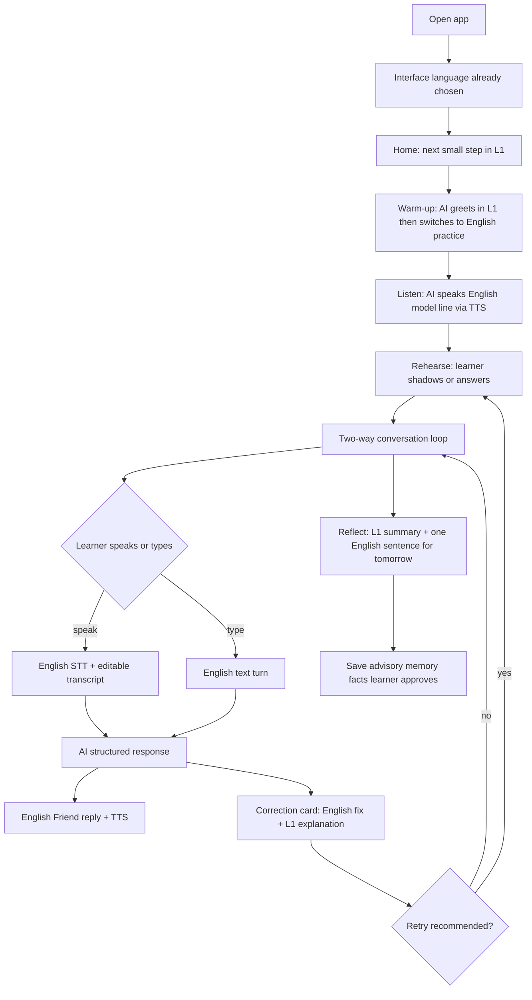
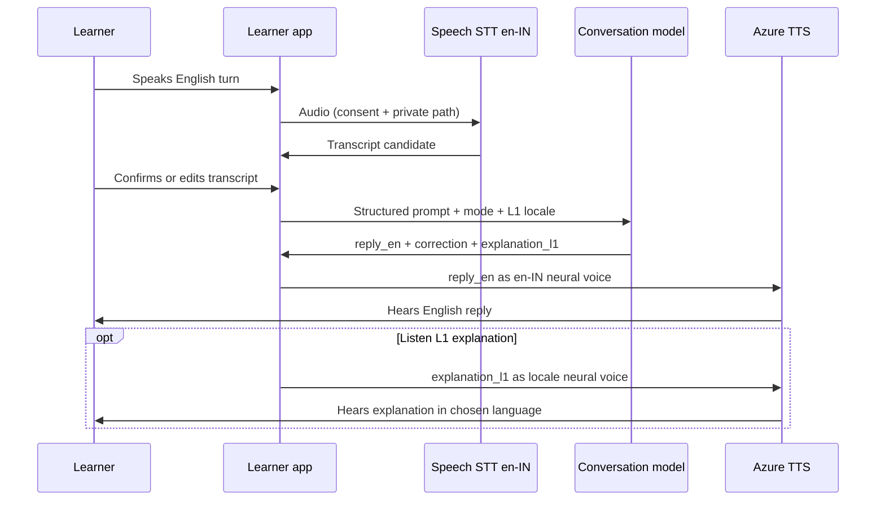

# Student AI conversation learning flow

**Status:** Product design accepted as the UX spine for APP-0021 Confidence Conversation (enterprise path). Not a substitute for the [spec](CONFIDENCE_CONVERSATION_SPEC.md) or [verification scope](CONFIDENCE_CONVERSATION_VERIFICATION_SCOPE.md).  
**Date:** 2026-08-07  
**Enterprise delivery plan:** [ENTERPRISE_STUDENT_PATH_PLAN.md](ENTERPRISE_STUDENT_PATH_PLAN.md) — Active step **A7**.  
**Aligns with:** master plan §§4–7, 14 (Tutor + Friend + correction object); extends L1 guidance from Kannada-first to all Phase 1 UI locales (`kn`, `hi`, `ml`, `ta`, `te`, `en`).  
**Hard product rules:**

- No human-recorded lesson audio. All spoken output is AI TTS.
- Learning language remains **English (`en-IN`)**.
- Guidance / grammar explanation language = learner’s **interface language**.
- AI is advisory: it must not set marks, mastery, attendance, or unlocks.
- Built for adults who lack confidence for a one-to-one with a real person.

---

## 1. Student promise

> Open the app in my language. Hear English spoken by AI (never a taped lesson). Talk back and forth with a patient AI partner. When I make a mistake, hear a clear English fix and an explanation in my language — without shame — then try again.

Success for a shy learner is not “perfect English.” It is:

1. they spoke;
2. they were understood;
3. they got one clear improvement;
4. they will open the app again tomorrow.

---

## 2. Language model (what speaks what)

| Channel | Language | Voice |
|---|---|---|
| UI chrome (buttons, notices) | Interface locale | — |
| Model English to practise / imitate | English | Azure neural TTS `en-IN` |
| AI conversational reply (what Friend says back) | English (simple) | Azure `en-IN` |
| Grammar correction phrase | English | Azure `en-IN` (optional replay) |
| Why it was wrong / how to fix | Interface locale (`kn`/`hi`/`ml`/`ta`/`te`/`en`) | Azure neural TTS for that locale **or** text-first if TTS quality is weak |
| Learner speech recognition | English (`en-IN`) | STT; learner may edit transcript |

Free/general LLMs are not assumed flawless in Indic languages. The design therefore:

- keeps **practice turns in English**;
- requires **structured L1 explanation fields** validated and eval’d per locale;
- allows **text-first L1** with optional TTS, so a bad Indic voice never blocks learning.

---

## 3. Emotional design (confidence first)

Default mode: **Gentle Friend**.

- Respond to **meaning first**, correction second (separate card, not mixed into the reply).
- At most **one priority correction** per turn.
- Always offer: **“Say that again”**, **“Type instead”**, **“Skip this turn”**, **“I need a hint in my language”**.
- Never mock accent, speed, or silence. Silence after 8s → soft L1 prompt, not a timeout scold.
- Progress celebration is small and private (“You spoke 4 turns today”), not public ranking.

Coaching modes (learner-controlled):

| Mode | Behaviour |
|---|---|
| Gentle Friend | Natural chat; ≤1 correction after the turn |
| Tutor | Shorter chat; explain + require one retry |
| Fluency | Longer turns; fewer interruptions; summary at end |

---

## 4. End-to-end daily flow



### Stage detail

#### A. Warm-up (30–60 seconds)
- L1: “Today we only talk. Mistakes are OK.”
- English: one easy personal question (“What did you do this morning?”).
- No marks in this stage.

#### B. Listen (AI-only audio)
- AI TTS speaks 1–2 short English model lines for the day’s micro-skill (e.g. past simple).
- Learner can replay; no download of human recordings.
- Optional: show English text + L1 gloss.

#### C. Rehearse
- Learner repeats or answers once.
- STT → editable transcript (learner always owns the text that continues).

#### D. Two-way conversation (core)
- 4–8 turns of Friend dialogue on a safe everyday topic.
- Each turn returns a **structured object** (below), never a free blob.
- Auto-play English reply TTS; L1 explanation is expandable / “Listen in my language”.

#### E. Reflect
- L1: what went well + the one pattern to remember.
- English: one “carry sentence” to reuse tomorrow.
- Optional save to learner-visible AI memory (explicit approve only).

---

## 5. AI turn contract (must be structured)

Every model call returns validated JSON (project-owned schema), for example:

```json
{
  "assistant_reply_en": "That sounds like a busy morning. What did you eat?",
  "understood_intent": "described_morning",
  "priority_correction": {
    "needed": true,
    "learner_span": "I go to market",
    "correction_en": "I went to the market",
    "error_category": "grammar.tense.past",
    "explanation_l1": "ನಿನ್ನೆ/ಈಗಾಗಲೇ ನಡೆದುದನ್ನು ಹೇಳುವಾಗ past tense ಬೇಕು — went.",
    "retry_recommended": true,
    "encouragement_l1": "ಚೆನ್ನಾಗಿದೆ — meaning clear. One small change only."
  },
  "safety_state": "ok",
  "coaching_mode": "gentle"
}
```

Rules:

- `assistant_reply_en` is spoken by Azure `en-IN` TTS.
- `explanation_l1` / `encouragement_l1` use the active UI locale catalogue language.
- If correction `needed=false`, omit teaching pressure; continue conversation.
- Validator rejects mixed-language correction fields, empty explanations when `needed=true`, or unsafe content → curated fallback turn.

---

## 6. Voice stack (no recorded lessons)



- **No CMS audio assets** for lessons. Curriculum supplies text/objectives; speech is synthesized at runtime (with short cache if needed).
- STT remains English-first for learning turns.
- Multi-locale Azure voices (already mapped in demo) serve L1 explanation playback.

---

## 7. Session types (same engine, different pressure)

| Session | Goal | Turns | Correction |
|---|---|---|---|
| Confidence chat | Reduce fear of speaking | 4–6 | Gentle, optional retry |
| Skill focus | One grammar/function | 5–8 | Tutor mode default |
| Role-play | Real situation (shop, interview) | Observe→Rehearse→Perform→Reflect | After perform |
| Review | Retry yesterday’s carry sentence | 2–3 | Light |

Shy-learner default entry: **Confidence chat**, not Role-play.

---

## 8. What “done” means for helping students

A release is student-helpful only when all are true:

1. Learner can complete a full warm-up → listen → converse → reflect loop with **zero human recordings**.
2. Every correction shows **English fix + L1 explanation** in their selected UI language.
3. Transcript edit is always available; typing always available.
4. Offline/fallback: deterministic micro-lesson text path still works if AI/TTS fails.
5. Evaluation fixtures exist per UI locale for explanation quality (not only English).
6. Marks/mastery still come from deterministic checks — conversation remains advisory.

---

## 9. Gap vs current repository

| Design need | Current state |
|---|---|
| Two-way confidence chat | Demo Friend: OpenRouter free **or** patterns; not production-bound |
| L1 grammar explanation | Partial (e.g. kn fields); not full 6-locale structured pipeline |
| AI-only lesson audio | Demo Azure TTS; production STT/TTS still gated / English-locked in ADR-0008 |
| No recorded lessons | Aligned as product intent; content still synthetic |
| Production integration | Not authorized (Play/production; real LLM DI) |

---

## 10. Suggested delivery slices (authorization required)

1. **APP: Confidence Conversation vertical slice** — structured LLM output + L1 explanation for all UI locales + Azure TTS playbook; Gentle mode only; demo + API path behind drivers.
2. **ADR amendment** — allow multi-locale TTS for *guidance* audio while keeping STT/`en-IN` for learning speech (or keep L1 text-first until eval passes).
3. **Eval** — locked fixtures: false-correction rate, L1 explanation adequacy per locale, shame-language ban list.
4. **PR-012 role-play** — only after confidence chat works for shy learners.
5. **Production binding** — separate spend, DPA, and release reviews; not the demo OpenRouter key path.

---

## 11. Explicit non-goals (this design)

- Replacing teachers for certification or high-stakes exams.
- Dialect labeling of the learner.
- Auto-saving private life details into memory without explicit approve.
- Google/live web tools for weather/time inside the confidence chat (optional later; must not block speaking practice).
- Claiming free models are flawless in all Indic languages.
