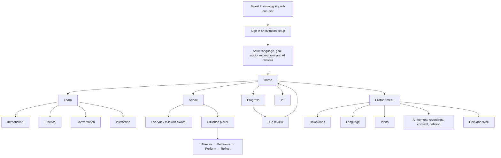
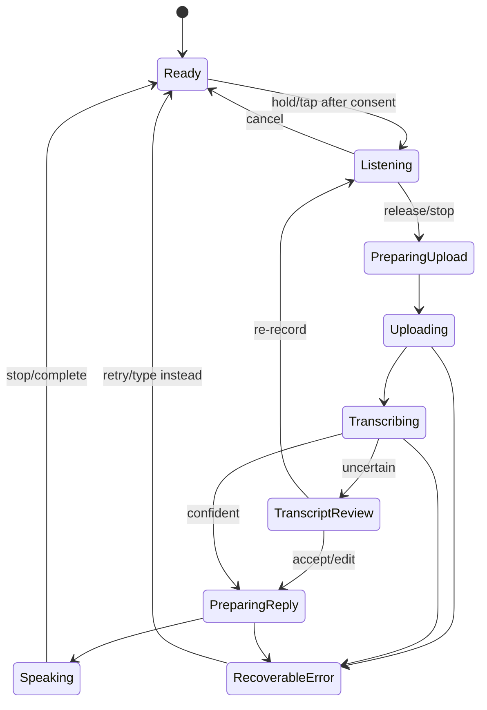

# Global English — UI/UX Product Architecture and Execution Plan

## 0. Purpose, authority and working agreement

This document turns the canonical product requirements into a practical,
incremental UI/UX programme. It is a delivery companion to the
[Enterprise Product Master Plan](../ENTERPRISE_PRODUCT_MASTER_PLAN.md); it does
not replace the master plan, accepted ADRs, approved specifications or the
current checkpoint.

It complements the aspirational
[World-class Production Plan](WORLD_CLASS_PRODUCTION_PLAN.md) by defining the
learner/operator experience and testable UI sequence. That aspirational plan is
useful strategy input but is not canonical authority unless separately accepted.

The proposed product position is:

> The calmest, clearest Kannada-guided path for an adult to understand useful
> English, speak it without embarrassment, improve one priority issue and use
> it in real life.

This is a feature and interaction benchmark, not an efficacy ranking. Public
vendor descriptions show what each product currently presents; they are not
treated as independent proof of learning outcomes. Feature availability can
vary by platform, language, subscription and region and must be rechecked when
an implementation decision depends on it.

### 0.1 Non-negotiable authority

The following existing decisions remain fixed unless amended through the
repository's decision process:

- the learner navigation is exactly **Home · Learn · Speak · Progress · 1:1**;
- Learn uses **Introduction → Practice → Conversation → Interaction** for every
  configured level;
- Speak contains everyday conversation with Swathi and the situation/Role-play
  picker; Role-play is not a sixth primary destination;
- Home has one deterministic dominant action: due review first, otherwise the
  recommended practice;
- English is the learning language; Kannada is the default UI and explanation
  language; the learner picker remains Kannada + English; the other approved
  Phase-1 catalogues are UI-only and are not silently enabled;
- AI replies and coaching are advisory; marks, mastery, review, progression,
  access and retention remain deterministic;
- downloaded deterministic learning remains usable without AI;
- web/PWA uses Sanctum cookie sessions and Android uses the approved Passport
  family with reviewed native secure storage;
- Phase 1 is adult-only and targets WCAG 2.2 AA;
- production, public release, live payments and Google Play remain separately
  gated.

### 0.2 How to use this plan

1. Accept the target experience and the next bounded UX checkpoint.
2. Change only that checkpoint's vertical slice.
3. Validate it with representative learners and the stated automated/manual
   gates.
4. Record evidence and update `docs/STATUS.md`, `docs/DECISIONS.md` and
   `docs/QUALITY_REVIEW.md` when the checkpoint is completed.
5. Start the next checkpoint only after the current exit gate is green.

Checkpoint statuses in §11 are the working tracker. A proposed checkpoint is
not implementation authorization by itself.

---

## 1. Executive direction

Global English should not become a regional visual clone of Duolingo or a
generic chatbot with lessons around it. Its strongest defensible experience is
the combination that the benchmark products usually specialize in separately:

- adult, real-life curriculum;
- native-language reassurance for a hesitant beginner;
- high-frequency speaking and retry;
- an AI partner with explicit state and bounded memory;
- governed lesson audio and deterministic progress;
- realistic Role-play and a route to human help;
- low-cost Android, low-bandwidth and offline resilience;
- transparent consent, subscription minutes and data controls.

The experience should feel **warm, mature, encouraging and locally grounded**.
It should not feel childish, exam-heavy, crowded, technically complex or
punitive.

### 1.1 Primary experience promise

Every important learner surface should answer four questions immediately:

1. **What should I do now?**
2. **How long will it take?**
3. **What is the app doing with my voice or work?**
4. **What small improvement did I make and what should I try next?**

### 1.2 Product-level success outcome

The UI exists to increase the canonical north-star behaviour: learners who
complete at least three meaningful speaking-practice sessions and one delayed
review in a week. Page views, XP-like decoration and content consumption alone
must not masquerade as learning progress.

---

## 2. Current experience baseline

### 2.1 Foundations already worth preserving

- A learner-facing five-destination navigation is implemented.
- Home, the four-session level path, Speak, Role-play, Progress, subscriptions,
  1:1 requests and offline learning have real product components rather than
  only mockups.
- The design-system package contains an application frame, primary navigation,
  mixed-language text and accessible audio/recording primitives.
- Six interface catalogues and self-hosted Kannada, Malayalam, Tamil, Telugu and
  Devanagari fonts exist.
- Voice capture exposes explicit listening, processing, preparing and speaking
  states, with text fallback and transcript recovery paths.
- The product has deterministic meaningful-speaking streaks, review schedules,
  evidence and entitlement meters behind the UI.
- Component, integration, accessibility and critical-journey test foundations
  already exist.

### 2.2 Baseline problems to resolve before visual expansion

The 4 September 2026 repository audit found the following UI/UX release
blockers in the current working tree:

- 13 of 21 Playwright journeys fail; failures mix real regressions with stale
  route/interaction expectations;
- normal-size text contrast fails on current Academy teal/coral combinations;
- the marketing carousel has an invalid `tablist`/tab relationship;
- the shell horizontally overflows at 320 CSS pixels;
- the current theme overrides the full Indian-script font stack and adds
  runtime Google Font requests, weakening offline, privacy and same-origin
  behaviour;
- entitlement-loading failures look like “Premium required,” which can lock a
  paid learner out during an API outage;
- first use currently asks only for adult confirmation and a goal; the required
  language/accessibility setup, audio-led orientation, placement and contextual
  voice/AI choices are incomplete;
- a due review is incorrectly coupled to the presence and estimated time of
  `next_mission`, so a review can disappear or show the wrong duration;
- high-confidence speech transcripts can advance without giving the learner the
  universal accept/edit/discard recovery promised by the product contract;
- Role-play names four learning stages but currently advances past Observe and
  Rehearse automatically;
- model audio lacks the required slow-speed and resume-position experience;
- Progress contains hard-coded/machine-facing labels, excessive tab stops and
  no error retry, while Account is not yet the coherent privacy/download/help
  hub required by the master plan;
- operator headings/landmarks have hierarchy and naming problems;
- the main web bundle is approximately 1.315 MB minified and eagerly imports
  learner, marketing and operator experiences;
- a 1,459-line application shell and several 1,800–3,200-line screens make
  interaction changes risky;
- the downloadable Android APK embeds an obsolete ephemeral tunnel origin.
- installability and native release handling are incomplete: the web app has no
  manifest link, sync lacks bounded backoff/schema migration coverage, generated
  Android tests are placeholders, and copying the APK through Vite `public/`
  risks packaging an older APK inside the next APK.

**Rule:** UX-00 fixes these regressions without opportunistically redesigning
later journeys.

### 2.3 Current implementation traceability

| Experience | Primary implementation |
|---|---|
| Shell, session resolution and hash routing | [`apps/web/src/App.tsx`](../apps/web/src/App.tsx) |
| Shared application frame/navigation/media primitives | [`packages/design-system/src`](../packages/design-system/src) |
| Home, mission and offline/sync loop | [`apps/web/src/learner/LearnerJourney.tsx`](../apps/web/src/learner/LearnerJourney.tsx) |
| Four-session path and model audio | [`LevelPathPanel.tsx`](../apps/web/src/learner/LevelPathPanel.tsx), [`ModelAudioPlayer.tsx`](../apps/web/src/learner/ModelAudioPlayer.tsx) |
| Speak, voice capture, conversation and Role-play | [`apps/web/src/conversation`](../apps/web/src/conversation) |
| Progress | [`ProgressDashboard.tsx`](../apps/web/src/learner/ProgressDashboard.tsx) |
| Plans and 1:1 | [`apps/web/src/subscriptions`](../apps/web/src/subscriptions), [`TuitionRequestPanel.tsx`](../apps/web/src/learner/TuitionRequestPanel.tsx) |
| Operator workspace | [`apps/web/src/operator`](../apps/web/src/operator) |
| Theme layers | [`apps/web/src/theme`](../apps/web/src/theme), [`App.css`](../apps/web/src/App.css) |
| Browser journey gates | [`apps/web/e2e`](../apps/web/e2e) |
| Android production-path wrapper | [`apps/web/android-app`](../apps/web/android-app) |

---

## 3. Global product benchmark

### 3.1 Benchmark set

The set is selected by interaction model, not by a claim of exact market rank:

- **Duolingo** — habit, path and character-led practice;
- **Babbel** — structured adult learning and calm scenario conversation;
- **Busuu** — curriculum timeline plus a dedicated speaking space and review;
- **ELSA Speak** — English-speaking diagnostics, bilingual support and Role-play;
- **Speak** — speech volume, guided repetition and AI application;
- **Memrise** — model/native-speaker media followed by AI practice;
- **Cambly** — goal-led continuity with a human tutor.

### 3.2 Comparative patterns

| Product | Strong current pattern | What Global English should borrow | What Global English should avoid |
|---|---|---|---|
| Duolingo | A single guided path, short practice, strong habit cues and level-adjusted AI conversation | One obvious next action, compact sessions, memorable but brief celebrations, conversation difficulty that follows the learner | Guilt-driven return tactics, noisy reward economies, learning progress represented by XP alone, sarcasm that can shame a hesitant adult |
| Babbel | Adult real-life curriculum; Speak presents scenario → task preview → conversation → feedback, with repeat, slow, translation and hints | Calm task preview, low-pressure speaking, hints on demand, no mid-turn correction, feedback after task completion | Burying speaking as a premium side feature or making every screen text-heavy |
| Busuu | AI conversations appear both in a dedicated Speak tab and at relevant points in the course timeline; feedback is delayed until the conversation ends | Preserve the canonical Speak destination while embedding lesson-linked Conversation/Interaction at the right learning moment; show both strengths and corrections | Community correction without the moderation/privacy design; purchasable streak repair, which conflicts with ADR-0028 |
| ELSA Speak | Goal-based personalization, bilingual beginner support, AI Role-play, focused pronunciation feedback and skill progress | Goal-led onboarding, bilingual confidence ramp, scenario library, actionable feedback hierarchy and visible growth by skill | Pseudo-precise fluency/pronunciation scores, native-accent conformity, or allowing advisory speech signals to control mastery |
| Speak | Learn → practise repeatedly → apply in a real exchange; speaking begins early and retry is central | Maximize learner speaking time, reuse a useful phrase across situations, keep Swathi reachable, make retry feel normal | Unbounded AI-generated curriculum, hidden personalization logic, or broad relationship/memory claims |
| Memrise | Observe useful language in model/native-speaker video, then practise with an AI partner | Preserve governed model audio/video before production and application; match media to the exact phrase/objective | Dependence on unlicensed third-party media, high-data autoplay, or an endless browsing feed that competes with today's action |
| Cambly | Goal matching, tutor continuity, real conversation and a human-feedback route | Make 1:1 a clear escalation path, carry the learner's goal and practised scenario into the request, show status honestly | Pretending that instant tutors, booking, recording or 24/7 service exist before those operational capabilities are approved |

### 3.3 Capability-positioning matrix

This matrix records the design emphasis visible in official product material;
`—` means it was not part of this benchmark, not that the product lacks it.

| Experience dimension | Duolingo | Babbel | Busuu | ELSA | Speak | Memrise | Cambly | Global English target |
|---|---|---|---|---|---|---|---|---|
| Guided curriculum path | Strong | Strong | Strong | Strong | Strong | Moderate | Moderate | **Strong, governed four-session path** |
| Speaking-first interaction | Moderate/strong | Strong in Speak | Strong in Conversations | Strong | **Core** | Strong | **Core human** | **Core from first useful session** |
| Real-world Role-play | AI calls/role-play | Strong | Strong | Strong | Strong | Scenario practice | Human conversation | **Observe → Rehearse → Perform → Reflect** |
| Beginner L1 reassurance | Course-dependent | Native-language-tailored courses | Interface/course-dependent | Bilingual mode | Localized support | Localized support | Tutor-dependent | **Kannada-first, progressively disclosed** |
| Feedback timing | Low-pressure/post-call | Post-conversation | Post-conversation | Immediate/post-task | During/after practice | Practice support | Human/post-lesson | **Meaning first; one priority correction; retry** |
| Habit/progress | Highly gamified | Structured review | Streak/review/certificates | Skills/achievements | Personalized path | Goal/streak | Goal/tutor continuity | **Meaningful speech + can-do evidence + due review** |
| Human escalation | — | Live products outside benchmark | Community/live options | Enterprise/teacher products | — | — | Core | **Governed 1:1 request, not false instant booking** |
| Low-bandwidth/offline trust | Some lesson support | Platform-dependent | Advertised offline mode | — | — | Media-heavy | Live-network dependent | **Explicit offline deterministic path** |

### 3.4 Strategic conclusion

The target is best understood as:

> **Babbel's adult clarity + Speak's speaking volume + Busuu's placement of
> conversation + ELSA's feedback focus + Duolingo's next-action discipline +
> Memrise's observe/practise bridge + Cambly's human escalation**, constrained
> by Global English's stronger Kannada, deterministic-record, privacy,
> low-bandwidth and tenant-safety rules.

No competitor's visual trade dress, character, wording, lesson content or
interaction should be copied. We borrow principles and validate them with our
own adult learners.

---

## 4. Target experience principles

### 4.1 One primary action

Each learner screen has one visually dominant next action. Secondary choices
remain available but do not compete with it. Home never becomes a dashboard of
equal cards.

### 4.2 Speak before studying too much

The first useful experience should produce a safe spoken English turn within
minutes. Explanations are short, optional where possible and immediately
followed by speech.

### 4.3 Meaning before correction

Swathi responds to what the learner meant before offering one priority
improvement. During fluency/Role-play performance the app does not interrupt a
turn with grammar scoring. The learner can review and retry afterward.

### 4.4 Courage over perfection

Copy, motion and feedback normalize pauses, retries and mistakes. There are no
red failure walls for ordinary learning errors, no shaming streak loss and no
accent-elimination language.

### 4.5 Kannada support without cognitive overload

English remains visually primary for material being learnt. Kannada explains
purpose, meaning and correction through progressive disclosure. Mixed-language
text always carries correct language metadata and generous line height.

### 4.6 State is part of the interface

Listening, upload, processing, preparing, speaking, offline, queued, syncing,
failed, entitlement unavailable and exhausted states must be visibly and
semantically distinct. A spinner alone is not an explanation.

### 4.7 Progress means capability

Show “I can…” outcomes, useful speaking activity, retry improvement and due
review. The meaningful-speaking streak is supportive secondary chrome, not a
currency or gate.

### 4.8 Trust before monetization

Show current entitlement, remaining live-AI minutes, GST/payable amount,
expiry, what changes after purchase and recoverable error states before asking
for payment. Never interrupt an active speaking turn with an upsell.

### 4.9 Accessible and low-cost by default

Design first for a 320–360 CSS-pixel viewport, enlarged text, TalkBack,
one-handed use, intermittent connectivity and a low-cost Android device. Large
screens enhance rather than redefine the journey.

### 4.10 Human help remains human

The 1:1 area communicates request status, institute contact routes and what to
prepare. It never implies an in-app call, confirmed booking or guaranteed
availability that the service cannot deliver.

### 4.11 Patterns explicitly rejected

- guilt, countdown anxiety or punitive streak messaging;
- hearts/energy systems that block deterministic lessons;
- a childlike mascot dominating an adult work/opportunity product;
- authoritative pronunciation, fluency or employability scores generated by AI;
- unbounded chat presented as curriculum;
- hidden recording, autoplay recording or bundled consent;
- modal paywalls in the middle of a lesson or conversation;
- carousels as the only way to discover critical information;
- color-only status, tiny icon-only actions and placeholder-only labels;
- an infinite content feed that competes with the recommended next action.

---

## 5. Target information architecture

### 5.1 Learner architecture

#### Home

- one “Continue” card with task, reason, estimated time, progress and data size;
- due review supersedes the normal recommendation;
- connection/sync state and remaining live-AI minutes are compact utilities;
- meaningful-speaking streak and recent improvement are secondary;
- one service/support notice at most.

#### Learn

- adult roadmap rather than a game board;
- current level first, later available levels visible but quiet;
- each level exposes the four ordered sessions, completion state and why a
  later session is locked;
- listening model, useful chunks and speak/check actions share one consistent
  lesson frame;
- unavailable commissioned content is stated honestly.

#### Speak

- one room with two clear choices: everyday Swathi conversation or a situation;
- resume the last appropriate conversation only when privacy/memory policy
  permits;
- persistent primary hold/tap-to-talk action with an equally findable typed
  fallback;
- stop playback, repeat, slow down, transcript review and retry remain close to
  the turn—not buried in menus.

#### Progress

- “I can…” outcomes by confidence/evidence state;
- due and completed reviews;
- speaking activity and first-attempt-to-retry improvement;
- recurring improvement themes in plain language;
- no AI-authored marks and no dashboard overload.

#### Account / profile menu

- language and accessibility preferences;
- downloads plus persistent sync/help status;
- plan and remaining live-AI minutes;
- AI memory, recording/transcript history and consent controls;
- password, linked sign-in methods and active sessions;
- privacy export, correction, closure and deletion routes;
- legal/help information.

#### 1:1

- explain what support exists and what it does not;
- prefill only safe goal/scenario context with the learner's knowledge;
- show request status and next expected human action;
- expose configured phone/WhatsApp/email only when valid.

### 5.2 Guest and acquisition architecture

The guest page has one narrative sequence:

`Promise → See the four-session method → Hear/see one safe example → Why
Kannada guidance helps → Plans from live catalogue → Privacy/trust → Install or
Sign in`

It should favor real product UI and governed media over a large rotating stock
photo carousel. Prices must come from the authoritative catalogue rather than
the client bundle. The Android download is shown only when the artifact origin,
version and availability are current.

### 5.3 Operator architecture

The operator workspace remains separate from learner navigation and derives
destinations from permissions:

`Overview · People · Learners · Learning · Entitlements · Operations · Safety`

Account settings remain in the account/profile area rather than becoming a
learner-style primary destination.

Principles:

- task-based labels, not backend module names;
- persistent desktop sidebar and compact mobile disclosure;
- one active workspace at a time, with breadcrumbs/back-to-overview;
- independent loading/error/retry for panels;
- tables for comparison, cards for summaries, forms for bounded commands;
- explicit unsaved, conflict, one-time-secret and audit states;
- destructive or privileged actions use clear confirmation and focus return;
- no raw learner audio/transcript exposure without the already-approved purpose
  and consent boundary.

---

## 6. Core journey blueprints

### 6.1 First use and first spoken success

`Sign in → Welcome/value → adult confirmation → UI language → goal → audio
check → explain voice/AI purposes → optional microphone try → one short model →
first safe spoken/typed turn → meaning-first response → celebrate useful action
→ Home`

**Prototype hypothesis:** an already-enrolled adult should reach the first
meaningful spoken exchange within 90 seconds after authentication. This is a
research target, not an accepted service level or permission to omit consent.

Design requirements:

- progress is visible, but the learner can go back;
- consent is purpose-specific and never preselected;
- permission denial offers typed practice without falsely awarding spoken
  mastery;
- “I cannot speak now” offers a quiet listen/type path without shame or lost
  progress;
- a learner can defer optional personalization;
- first success celebration is brief and adult.

### 6.2 Daily return

`Open → session/sync resolved → due review or today's recommendation → Continue
→ complete meaningful speech → concise result → next review/action`

Do not place plan advertising, multiple equal recommendations or operator-like
metrics above Continue.

### 6.3 Four-session level path

1. **Introduction:** goal, exact governed audio, transcript, short Kannada
   explanation and a speak-heavy noticing action.
2. **Practice:** model/repeat/transform, playback and deterministic Check.
3. **Conversation:** lesson-scoped free speech, meaning-first reply and separate
   coaching.
4. **Interaction:** freer Friend/light Role-play Apply task.
5. **Delayed review:** returns through Home later; it is not a fifth first-run
   tab.

### 6.4 Speaking turn

Every state needs visible copy, semantic status, a valid cancel/recovery action
and no sensitive content in telemetry.

### 6.5 Correction and retry

Order the result as:

1. what Swathi understood;
2. conversational response/task outcome;
3. one priority improvement;
4. corrected English and optional natural alternative;
5. concise Kannada explanation;
6. Listen and Try again;
7. secondary “see more feedback” disclosure.

### 6.6 Role-play

- **Choose:** goal, role, difficulty, time and required live-AI minutes.
- **Observe:** short dialogue with replay/slow/transcript.
- **Rehearse:** useful chunks and optional hints.
- **Perform:** uninterrupted bounded exchange with visible stage/state.
- **Reflect:** task completion, what worked, one priority correction and retry.

### 6.7 Subscription and exhaustion

`Current plan/minutes → threshold warning → finish current safe boundary → clear
options → exact GST/payable breakdown → pending payment → completed/recoverable
failure → entitlement refreshed`

“Unable to load entitlement,” “no active plan” and “minutes exhausted” are
different states. Talk packs do not look like replacement membership plans and
must state expiry and prerequisites before checkout.

### 6.8 Offline and sync

`Choose download → size/expiry/device notice → download progress → Ready
offline → local completion → Saved on this device → Syncing → Synced or Needs
attention`

Logout with pending work must show the exact count and consequences before the
learner chooses sync, keep working or discard under the accepted offline policy.

---

## 7. Visual and interaction system

### 7.1 Accepted visual character — Futuristic Learning Studio

D-0279 replaces the proposed Warm Academy direction with **Futuristic Learning
Studio**. This is a calm, premium AI-learning environment for adults—not a
recolored legacy education template and not a noisy cyberpunk game.

- **Personality:** forward-looking, intelligent, focused, encouraging and
  unmistakably adult. Warmth comes from language and coaching, while the visual
  system communicates capable technology and calm progress.
- **Default guest atmosphere:** a deep ink/navy canvas with controlled aurora
  depth, subtle grid/orbit geometry and luminous **brand-green** (`#00A86B` /
  `#006B3F`) and violet accents, with brand red (`#E31C23`) for identity
  emphasis. Header, favicon and Android launcher use the Global Spoken English
  App brand kit (D-0285). An equivalent high-contrast light theme must retain
  the same identity.
- **Surfaces:** layered solid/translucent panels with clear boundaries and an
  opaque fallback. Glass effects are progressive enhancement; text never
  depends on backdrop blur for contrast.
- **Primary actions:** one high-salience luminous action per region. Secondary
  actions remain quiet and states are never conveyed by glow or color alone.
- **Tutor presence:** Swathi appears as an explicitly labelled AI coach through
  an original abstract presence, voice pulse or restrained character treatment;
  never as an undisclosed human or a conflicting Maya identity.
- **Imagery:** original product UI, abstract AI/voice forms and licensed adult
  real-life context where it materially improves understanding. The old
  five-image Academy carousel stays removed. A **static** Global Spoken
  English App brand banner (name + tagline, no autoplay slides) is required
  on the guest first screen (D-0286).
- **Motion:** slow ambient depth plus purposeful voice/status transitions. No
  autoplay content carousel, parallax trap, flashing neon or motion required to
  understand state. Reduced-motion produces an equally complete static design.
- **Typography:** expressive display type is limited to short English headings;
  the full self-hosted Noto script stack remains authoritative for Kannada and
  other Indian scripts.
- **Accessibility:** body copy always sits on a stable AA surface; focus is
  visibly brighter than decorative glow; controls remain at least 44 CSS pixels;
  320-pixel and 400%-text layouts take precedence over decorative composition.
- **Performance:** futuristic depth should come primarily from CSS, optimized
  SVG and small responsive assets—not autoplay video or a WebGL dependency.

The following are explicit anti-goals: stock-template section repetition,
legacy school/academy chrome, decorative sci-fi jargon, fake live-AI claims,
unlicensed futuristic artwork, low-contrast glass text, excessive neon,
horizontal showcase scrolling required for comprehension and animation that
delays the first useful action.

### 7.2 Typography

- self-host the complete approved Indian-script variable font stack;
- do not fetch fonts from Google or another runtime third party;
- use one display family only when it preserves every script fallback;
- use a minimum comfortable learner body size and generous line height;
- test mixed Kannada/English wrapping, numerals, currency and form errors at
  320 px and enlarged text;
- use sentence case and plain adult language.

### 7.3 Core reusable components

Build or consolidate these components only as their vertical slice needs them:

- Application shell and destination navigation;
- Primary action / Continue card;
- Connection, sync and entitlement status strip;
- Four-session stepper;
- Model audio player with transcript and speed;
- Voice turn control and state announcer;
- Transcript review/editor;
- Meaning-first response and priority-correction card;
- Scenario card and Role-play stage indicator;
- Can-do outcome and due-review card;
- Plan/talk-pack card with authoritative price breakdown;
- Standard loading, empty, unavailable, denied, exhausted and retry states;
- Operator page header, task navigation, table, command form and confirmation.

Do not create a large unused component library in advance.

### 7.4 Responsive layout

- design and test at 320, 360, 412, 768 and 1280 CSS pixels;
- learner content uses a narrow reading/speaking column on large screens;
- primary mobile navigation stays thumb-reachable and safe-area aware;
- no fixed-width selector, table or CTA can force horizontal page scrolling;
- operator tables may use an explicitly labelled internal scroller, responsive
  column priority or detail view—the document itself must not overflow;
- touch targets are at least 44 × 44 CSS pixels except documented WCAG spacing
  alternatives.

### 7.5 Performance budgets

Initial budgets to validate on a representative low-cost Android device and
constrained network:

- route-level code splitting so a learner does not download operator code;
- target initial application JavaScript below 250 KB gzip, with exceptions
  measured and documented;
- avoid autoplay video/audio and load non-critical marketing media lazily;
- cache only approved public shell/fonts and explicitly protected offline data;
- show an interaction response within 100 ms and the known-dependency fallback
  within the master-plan two-second target;
- retain the voice end-of-turn latency targets from the master plan.

---

## 8. Accessibility, localization, privacy and trust definition

### 8.1 Automated acceptance for every critical learner slice

- zero known critical/serious axe violations in all enabled interface locales;
- semantic heading and landmark order;
- full keyboard operation and visible focus;
- announced loading, processing, error and completion states;
- 320-pixel reflow and 200%/400% text-size stress without document overflow;
- reduced-motion coverage;
- 44-pixel target checks;
- local font-resource and correct `lang` assertions;
- no status conveyed by color alone.

### 8.2 Manual acceptance before release claims

- TalkBack on representative low-cost and current Android devices;
- browser keyboard and screen-reader checks for operator critical paths;
- real browser zoom rather than only root-font-size simulation;
- Kannada plus each enabled script reviewed for glyphs, wrapping and meaning;
- permission denial, interruption, phone call/audio focus, background/resume and
  poor-network exercises;
- quiet-room and noisy-room speaking tests with consenting adults.

### 8.3 Trust rules

- state whether the user is interacting with AI;
- explain recording, provider processing, transcript history and deletion as
  separate purposes;
- make withdrawal as findable as grant;
- show what remains only on device, what is queued and what reached the server;
- never expose raw sensitive content in analytics, logs or operator search;
- show current plan/minutes from the authoritative API with an “unavailable”
  state rather than guessing;
- never imply publication, review, human availability or language capability
  beyond the approved state.

---

## 9. Content design system

### 9.1 Voice and tone

- supportive, direct and adult;
- short Kannada explanations paired with useful English;
- one instruction per action;
- action labels describe the result: “Try again,” “Review transcript,” “Save on
  this device,” not “OK”;
- errors explain what happened, whether work is safe and the next recovery;
- encouragement recognizes the action, not an unsupported ability claim.

### 9.2 Standard state vocabulary

Use consistent localized concepts for:

- Ready to speak;
- Listening;
- Preparing your recording;
- Sending securely;
- Checking what was heard;
- Preparing Swathi's reply;
- Speaking;
- Saved on this device;
- Syncing / Synced / Needs attention;
- AI temporarily unavailable;
- Plan information unavailable;
- Live-AI minutes exhausted;
- Review due.

Exact catalogue wording requires language review and must not be improvised in
component files.

---

## 10. Research, measurement and validation

### 10.1 Required learner research

Before declaring the target UX validated, run the master-plan Step-0 research:

- 15–20 representative Kannada-speaking adults across Pre-A1, hesitant
  school-English, opportunity and low-connectivity/shared-device profiles;
- multiple ages, occupations, literacy/digital-confidence levels and Karnataka
  speech groups;
- observed tasks, not opinion questions alone;
- explicit consent for any recording; no real learner data in Git.

Priority tasks:

1. understand the first action without facilitator help;
2. choose a language and goal;
3. play the model and complete the first speaking turn;
4. understand listening/processing/AI states;
5. interpret one correction and retry;
6. recover from microphone/network/STT failure;
7. find a due review and understand progress;
8. understand plans, remaining minutes and 1:1 limits;
9. remove a download, withdraw consent and find privacy controls.

### 10.2 UX scorecard

| Outcome | Primary measure | Guardrail |
|---|---|---|
| First speaking activation | % completing one useful turn without facilitator help; time to first useful speech | Permission refusal and typed fallback remain respected |
| Daily clarity | % selecting the intended dominant Home action | No rise in accidental starts/backtracking |
| Speaking loop | Completed meaningful turns and retries | No false completion or lost acknowledged turn |
| Feedback usefulness | Learner can explain the priority correction and improve on retry | Human-reviewed false-correction rate |
| Retention | Day-7/Day-30 and canonical weekly north-star | No guilt/shame complaints or meaningless streak inflation |
| Offline resilience | Valid offline completions confirmed after reconnect | No cross-profile exposure or silent loss |
| Subscription trust | Plan/minutes/price comprehension and successful recovery | No double charge or outage shown as upgrade requirement |
| Accessibility | Critical task completion with TalkBack/keyboard/enlarged text | No unresolved critical blocker |
| Performance | Route load and voice-state latency on target devices/networks | Bundle and media budgets |

Analytics record only minimized event categories, state durations and opaque
identifiers approved by privacy policy. They do not record raw audio,
transcripts, correction text or personal learner details.

### 10.3 Validation cadence

- usability-test low-fidelity wireflows before a large visual build;
- test the implemented vertical slice with 5–8 representative adults;
- include at least one low-connectivity and one accessibility-oriented session
  in each critical learner checkpoint;
- review funnel and failure telemetry after controlled rollout;
- change one major interaction hypothesis at a time;
- do not scale curriculum or languages to compensate for a broken core loop.

---

## 11. Ordered implementation roadmap

D-0276 completed on 5 September 2026. D-0280 records the Accountable Product
Owner's successful 320-pixel keyboard smoke and closes UX-00. D-0279 accepts
the Futuristic Learning Studio direction; D-0281–D-0283 complete UX-01A→G.
UX-02 and later remain unauthorized until separately accepted.

| ID | Checkpoint | Status | User outcome | Exit gate |
|---|---|---|---|---|
| UX-00 | Restore UX quality baseline | **Complete** | Current journeys are accessible, honest and testable again | Automated gates and the human 320-pixel keyboard smoke passed; Android TalkBack remains a release gate |
| UX-01 | Futuristic Learning Studio design language and shell | **Complete** | A genuinely new, coherent and fast learner frame replaces the legacy Academy template across web/PWA | UX-01A→G completed; token/component tests, all locale fonts, route splitting and bilingual 320/1280 evidence |
| UX-02 | Acquisition, sign-in and first spoken success | Proposed | An adult reaches a safe useful turn within minutes | First-use usability gate; permission/consent/auth recovery tests |
| UX-03 | Daily Home and return loop | Proposed | One clear next action with due review, sync and secondary streak | Home comprehension test; deterministic API contract and E2E |
| UX-04 | Four-session Learn journey | Proposed | Learner always understands current session, lock reason and next action | Introduction→Interaction vertical-slice E2E; offline/no-AI path intact |
| UX-05 | Speak and correction loop | **In progress — UX-05A implemented (D-0297)** | Fast, calm conversation with explicit state and a useful retry | Automated flow passes; physical Android ergonomics, real-provider latency and TalkBack remain |
| UX-06 | Role-play Studio | Proposed | Observe, rehearse, perform and reflect in a real-life situation | Scenario usability, version pin, safety and completion E2E |
| UX-07 | Progress and delayed review | Proposed | Learner sees capability, improvement and the right review—not vanity stats | Progress comprehension; deterministic/cross-tenant tests |
| UX-08 | Plans, 1:1, account, privacy and offline controls | Proposed | Commercial and trust choices are accurate and recoverable | Authoritative catalogue, failure/payment safety, privacy/offline E2E |
| UX-09 | Operator task architecture | Proposed | Staff complete authorized work without direct DB access or screen overload | Per-role task studies, keyboard/axe/reflow and tenancy tests |
| UX-10 | Android/device and release hardening | Proposed | The approved experience works on target phones and poor networks | Device matrix, TalkBack, lifecycle, performance, security and release gates |

### 11.1 UX-00 — exact first checkpoint

**Scope**

1. Replace runtime Google Font use with the existing self-hosted full script
   stack.
2. Correct Academy/text/action color pairs to WCAG 2.2 AA.
3. Repair carousel tab semantics or use a simpler accessible slide selector.
4. Remove 320-pixel and enlarged-text document overflow.
5. Add pause/stop behavior and complete keyboard semantics for moving carousel
   and tab interfaces.
6. Repair operator landmark names and heading order.
7. Model entitlement as loading, ready, unavailable, absent and exhausted;
   preserve paid access during a recoverable refresh failure where policy
   permits.
8. Reconcile Playwright fixtures/navigation with the accepted one-active-
   workspace and learner contracts; do not weaken valid assertions.
9. Make build/test output paths reproducible for non-root local and CI runs.

**Excluded**

- no new visual brand, onboarding, payment provider, API product feature,
  database migration or navigation change;
- no APK publication or production promotion;
- no later UX checkpoint refactor.

**Evidence**

- focused unit/component tests for each changed state;
- axe, keyboard, 320/360/412 widths, enlarged text, reduced motion and script
  fonts;
- complete 21-journey Playwright suite;
- `make verify`, `make e2e`, `make build` using pinned Node/PHP/PostgreSQL;
- screenshots at 320 and 1280 px in Kannada and English;
- manual keyboard smoke; TalkBack remains a release gate.

**Implementation result — 6 September 2026**

| Scope item | Result | Evidence |
|---|---|---|
| Self-hosted script fonts | Pass | Runtime Google Font requests were removed; locally bundled Latin, Kannada, Malayalam, Tamil, Telugu and Devanagari resources load in Chromium |
| AA colors, carousel and reflow | Pass | Academy teal/coral pairs were corrected; the carousel is a named region with pause/resume and button semantics; axe, target-size, 320/360/412 widths and 200%/400% enlarged-text checks pass |
| Operator structure | Pass | Duplicate landmark names and heading-order defects were removed; the five operator Chromium journeys pass |
| Entitlement truth | Pass | Loading, ready, unavailable, absent and exhausted are distinct; a transient refresh failure retains the last paid entitlement; institutional learners are not Direct-paywalled |
| Test contract and output isolation | Pass | One-active-workspace and Premium Role-play fixtures match accepted contracts; Playwright and PHPUnit artifacts use non-root `/tmp` paths with a UID/suite boundary |
| Pinned verification | Pass | PHP 8.4.23, Composer 2.10.2, Node 24.18.1, pnpm 11.18.0 and PostgreSQL 18.4: `make verify`, `make e2e` (21/21 Chromium plus 4/4 reconciliation integration tests) and `make build` |
| Visual evidence | Pass | [English 320](evidence/ux00/marketing-en-IN-320.png), [English 1280](evidence/ux00/marketing-en-IN-1280.png), [Kannada 320](evidence/ux00/marketing-kn-IN-320.png) and [Kannada 1280](evidence/ux00/marketing-kn-IN-1280.png). Kannada captures use the explicit development-preview policy because the changed catalogue revision requires renewed independent review |
| Human gates | Pass for checkpoint | Accountable Product Owner reported the 320 CSS-pixel keyboard smoke passed on 6 September 2026; representative Android TalkBack remains a release gate |

The production bundle is still approximately 1.319 MB minified (313.83 kB
gzip) and reports Vite's large-chunk warning. Code splitting belongs to UX-01,
not this bounded repair. The dependency gate has no high-severity finding;
`pnpm audit --audit-level=high` reports one non-blocking moderate advisory.

### 11.2 UX-01 — Futuristic Learning Studio implementation sequence

**Accepted outcome**

Replace the current Academy-derived guest presentation and fragmented shell
styling with the visual contract in §7.1. Preserve the canonical learner
navigation, content, prices, entitlement rules, language governance, AI
disclosure, authentication and deterministic authority. A futuristic visual
change must not silently become a product-policy change.

Only one sub-checkpoint below may be active at a time. Each produces a usable
vertical increment, focused tests and evidence before the next begins.

| Order | Status | Sub-checkpoint | Exact bounded scope | Exit gate |
|---|---|---|---|---|
| UX-01A | **Complete** | Served-build freshness | Make soft-launch rebuild/invalidation depend on current web source/config/lock/catalogue inputs; version the public shell cache from the built release; prove old public caches retire without deleting protected learner offline data | Change a fixture source, rebuild/restart, and prove the served JS/CSS/release digest changes; shell-cache unit/contract tests pass |
| UX-01B | **Complete** | Visual foundation and new first screen | Add only the used futuristic color, elevation, glow, typography, spacing and motion tokens; replace the old carousel/top fold with a responsive AI-learning-studio hero, one primary action and one secondary demonstration action | Accountable review of English and Kannada-preview screenshots at 320 and 1280; axe, keyboard, reduced-motion, target and enlarged-text tests pass |
| UX-01C | **Complete** | Complete public landing journey | Build the remaining guest hierarchy: product demonstration, four-step learning loop, real-life outcomes, AI/trust explanation, governed plan summary and closing action; remove legacy Academy section repetition | A new visitor can identify audience, value, first action, AI boundary and plan difference; no unsupported claim/price; guest E2E and performance budget pass |
| UX-01D | **Complete** | Sign-in transition | Restyle the dedicated sign-in, recovery and invitation entry surfaces as a continuous handoff from the new landing page without changing credential transport or enrollment rules | Keyboard-only landing→sign-in→recovery/invitation paths, password-manager semantics, no credential persistence, 320-pixel reflow and axe pass |
| UX-01E | **Complete** | Authenticated learner frame | Apply the visual system to the learner header, five-destination navigation, content canvas, connection/entitlement strip and Home entry without redesigning later destination workflows | Home and all five destinations remain reachable at 320/360/412; selected/focus/offline/unavailable states are distinct; accepted learner E2E remains green |
| UX-01F | **Complete** | Shared state primitives and boundary | Consolidate only primitives used by completed UX-01 surfaces; keep operator density/authority distinct while sharing safe tokens; lazy-load guest, learner and operator route families | No unused component-library scaffold; learner does not download operator route code; initial JS target is below 250 kB gzip or a measured exception is approved |
| UX-01G | **Complete** | Cross-surface evidence and closure | Run complete verification, responsive bilingual visual review and representative-device checks; document remaining debt and remove temporary compatibility styles | `make verify`, `make e2e`, `make build`; 21/21 browser baseline plus new UX-01 journeys; approved 320/1280 visual evidence; no critical/serious axe issue |

**UX-01A implementation result — 6 September 2026**

- A deterministic SHA-256 release fingerprint covers the served web source,
  configuration, workspace lockfiles, contracts, design-system sources and
  localization catalogues.
- Soft launch rebuilds when that fingerprint changes and exposes
  `make soft-launch-refresh-web`; an unchanged refresh keeps the same built
  assets.
- Vite embeds the fingerprint in the service-worker registration URL. The
  worker versions and retires only `global-english-public-shell-*` caches;
  protected learner IndexedDB data is untouched.
- A tracked source change changed the release fingerprint from
  `a14a93118c2d5b86e0505a1b2388bc7666a0a704587e1e5c0e07dbaa45a0d631`
  to `a9d06362265b660c48a60f11e0221c0f43267fce7f0bc140a358ea547c194557`
  and changed the served entry asset from `index-DRG7SBfg.js` to
  `index-DARKM3lG.js`. Focused fingerprint, registration and soft-launch
  contract tests pass. Exact pinned `make verify`, `make e2e` (4/4 integration
  plus 21/21 Chromium) and `make build` also pass.

**UX-01B implementation result — 6 September 2026; closed by D-0283**

- The Academy guest class, logo and five-image autoplay carousel were removed
  from the served first screen. The new guest shell uses an original code-native
  wordmark, deep ink/navy canvas, controlled cyan/teal/violet accents, stable
  text surfaces and restrained CSS-only voice/orbit geometry.
- The first screen now contains one primary sign-in action, one secondary
  four-session demonstration action, the canonical Introduction → Practice →
  Conversation → Interaction signal and an explicit textual Swathi AI boundary.
- English and Kannada-preview renders have zero horizontal overflow at 320 and
  1280 CSS pixels. Axe across all interface locales, keyboard entry, 44-pixel
  targets, 200%/400% enlarged text, self-hosted fonts and reduced motion pass.
- Exact pinned `make verify`, `make e2e` (4/4 integration plus 21/21 Chromium)
  and `make build` pass. D-0283 records Accountable Product Owner closeout of
  the visual review and continues through UX-01C–G.

**UX-01C–G implementation result — 6 September 2026 (D-0283)**

- The remaining guest page follows the hierarchy below. Plan SKU names stay
  English (`5-day start` / `Premium features` / `Premium with Role-play`);
  advertised prices are ₹3 / ₹300 / ₹500 GST exclusive (D-0286). The live
  entitlement engine may still return the previous snapshot until that slice
  ships.
- Dedicated sign-in and the authenticated learner Home/nav use the same Studio
  tokens. Guest, learner and operator families are `React.lazy` route chunks.
- Initial JS is 78.58 kB gzip (`index-DSDJ_Aqr.js`). Guest first visit plus
  `marketing-landing` is 235.77 kB gzip, under the 250 kB target. Operator code
  is a separate 52.57 kB gzip chunk. Vite still warns that the marketing chunk is
  676 kB minified.
- UI-only holes closed without new APIs: due-review duration uses
  `interval_days`; Role-play Observe/Rehearse are presented (D-0215's API start
  at observe is unchanged); transcripts always confirm; model audio 0.75× and
  resume; Progress retry and catalogue labels. Unused `academyExperience.css`
  was deleted.
- Evidence: `docs/evidence/ux01c/` and `docs/evidence/ux01g/`. Kannada captures
  use `VITE_UI_TRANSLATION_PREVIEW=true` and are not independent-review approval.

**Content hierarchy for the new guest page**

1. Futuristic hero with a static brand banner, useful English outcome,
   Kannada-guided reassurance and one clear start/sign-in action. The header
   has one Sign in. Plan cards do not repeat Sign in. Android APK download
   appears once, in the Android section.
2. Compact interactive product preview: Listen → Speak → Understand → Improve,
   with a non-recording alternative.
3. Real-life capability cards: work, customer conversations, education,
   interviews and everyday confidence.
4. Swathi/AI boundary: what AI can help with, what remains deterministic and
   what happens to voice data.
5. Plans: 5-day start, Premium features and Premium with Role-play using only
   the authoritative catalogue and
   explicit live-AI-minute/Role-play distinctions.
6. Trust and readiness: adult-only scope, Kannada guidance, low-bandwidth/offline
   path and access to human help.
7. Final action with no countdown, artificial scarcity or fluency guarantee.

**Global UX-01 constraints**

- Do not copy a competitor's trade dress, artwork, mascot, wording or layout.
- Do not add a new API, database field, payment gateway, navigation destination,
  AI provider or learning rule.
- Do not use remote fonts, raw provider SDK types, autoplay audio/video or
  browser-stored credentials.
- Do not publish a new APK, promote production or claim Kannada approval from a
  development-preview screenshot.
- Replace the old template incrementally; do not keep a hidden second homepage
  or long-lived parallel theme.

### 11.3 Standard checkpoint template

Every later UX checkpoint records:

- target learner/operator and job to be done;
- current evidence and problem statement;
- one journey/wireflow and content hierarchy;
- responsive, localization, accessibility, offline and failure states;
- data/API impact and explicit non-impact;
- privacy, security, tenancy and authoritative-record impact;
- component and E2E coverage;
- representative-user validation;
- files changed and commands actually run;
- known limitations and next checkpoint recommendation.

---

## 12. Decisions needed before later checkpoints

These are not blockers for UX-00 but must be resolved before their named work:

| Decision | Needed before | Recommended default |
|---|---|---|
| Approve the implemented UX-01B visual prototype against D-0279 | Resolved by D-0283 | Futuristic Learning Studio; APO instruction closed the screenshot review |
| Confirm one canonical visual identity/name for Swathi across existing tutor assets | UX-02/UX-05 | One clearly disclosed AI coach identity; no conflicting Maya/Swathi assets |
| Approve first-use goal and placement depth | UX-02 | Goal first; short placement that can be deferred, never infer ability from accent/location |
| Resolve UI-locale preference persistence between the current ephemeral ADR behavior and the master-plan preference model | UX-01/UX-02 | Keep the current ephemeral behavior until an explicit reviewed preference contract is accepted |
| Decide whether transcript history is offered during onboarding or contextually | UX-02/UX-05 | Contextual, off by default, separate consent |
| Define stable public Android origin/release channel | UX-10 | Named HTTPS production/staging origin; never publish an ephemeral-tunnel APK as current |
| Approve live payment workflow and recovery contract | UX-08/live payments | Durable pending/reconciliation design before any real capture |

Any ambiguity affecting consent, credential transport, authoritative progress,
payment records, tenancy or schema requires a decision request/ADR rather than
a visual assumption.

---

## 13. Risks and mitigations

| Risk | Design response |
|---|---|
| Attractive redesign hides broken journeys | UX-00 is mandatory and quality gates precede visual expansion |
| Five mobile destinations become crowded | Short labels, icon+text, safe-area layout and 320-pixel tests; do not add a sixth destination |
| Kannada guidance doubles every screen | Progressive disclosure and clear language hierarchy, not side-by-side duplication everywhere |
| Voice latency feels like failure | Explicit staged states, immediate acknowledgement, cancel and typed fallback |
| AI correction reduces confidence | Meaning first, one priority issue, neutral retry and feedback timing by coaching mode |
| Gamification distorts learning | Only meaningful speech counts; streak stays secondary and cannot be purchased/repaired |
| Personalization becomes opaque surveillance | Explain inputs, expose memory, minimize data and let learners edit/delete |
| Subscription limits surprise learners | Persistent minutes/status, threshold warnings and exact plan/talk-pack rules |
| Operator redesign leaks authority | Navigation and panels remain permission-derived; every command remains server-authorized and tenant-scoped |
| Media/fonts break offline or privacy | Self-host licensed assets, responsive variants, lazy loading and same-origin enforcement |
| Competitor copying weakens identity | Borrow interaction principles only; use original content, brand and validated learner research |

---

## 14. Official benchmark sources

Accessed 5 September 2026. Vendor statements describe their own products and
may change.

- Duolingo, [Video Call conversation design](https://blog.duolingo.com/video-call/)
  and [AI structure behind Video Call](https://blog.duolingo.com/ai-and-video-call/).
- Duolingo, [Path design](https://blog.duolingo.com/new-duolingo-home-screen-design/),
  [current practice surfaces](https://blog.duolingo.com/ways-to-practice-in-duolingo/)
  and [streak design](https://blog.duolingo.com/how-duolingo-streak-builds-habit/).
- Babbel, [Babbel Speak flow and controls](https://support.babbel.com/hc/en-us/articles/25875402999826-Babbel-Speak)
  [mobile information architecture](https://support.babbel.com/hc/en-us/articles/360029715892-Using-the-Babbel-app-on-a-mobile-device),
  [offline mode](https://support.babbel.com/hc/en-gb/articles/19176178120722-Offline-mode)
  and [expert-designed adult courses](https://www.babbel.com/babbel-language-experts).
- Busuu, [AI Conversations placement, structure and feedback](https://blog.busuu.com/new-conversations-release/)
  [Study Plan](https://help.busuu.com/hc/en-us/articles/16097312171153-What-s-a-Study-Plan-How-do-I-make-one)
  and [plan/feature comparison](https://www.busuu.com/en/premium-plans).
- ELSA Speak, [new application navigation and learning experience](https://blog.elsaspeak.com/en/discover-the-new-elsa-speak-experience/)
  and [AI Role-play flow](https://elsaspeak.com/en/ai/).
- Speak, [Learn → Practice → Apply method](https://www.speak.com/)
  [quiet/hands-free alternatives](https://help.speak.com/en/articles/7969186-what-are-hands-free-mode-and-i-can-t-speak-mode)
  and [Speak Tutor capabilities](https://help.speak.com/en/articles/11396739-what-is-speak-tutor).
- Memrise, [model-video and AI-partner pattern](https://www.memrise.com/en-us/learn-korean)
  and [current-experience/offline change](https://www.memrise.com/blog/major-update-a-new-version-of-the-app-is-coming).
- Cambly, [goal-led human conversation and tutor plans](https://www.cambly.com/english)
  and [lesson review](https://studentsupport.cambly.com/hc/en-us/articles/4418094099597-Lesson-review).

---

## 15. Progress log

| Date | Update | Evidence/status |
|---|---|---|
| 2026-09-08 | D-0302 repairs Kannada selection and refines the closed-beta Android Home | Debug-only reviewed-preview lane with visible warning; release remains fail-closed; one mission card now includes Swathi; compact type/chrome/actions retain 44px targets; 360px axe/reflow and full web/learner journeys pass; physical Android/TalkBack remain open. |
| 2026-09-07 | D-0300 repairs the rotated-host Android download/sign-in path | Rebuilt debug APK embeds the current live HTTPS tunnel; homepage link is cache-busted; external artifact and password-mode checks pass. UX-10 stable named origin remains open. |
| 2026-09-07 | D-0297 starts UX-05 with the mobile conversation cockpit | Compact stable recorder; explicit processing; D-0215 confident transcript auto-submit restored; everyday/Role-play bubbles grow below the recorder with inline correction; new remote APK published; human Android/TalkBack/latency exit remains. |
| 2026-09-07 | D-0296 corrects oversized typography on laptops, external monitors, and very large displays | Removed whole-page 137.5% magnification; browser-default root and 14/16/18px-equivalent shared scale; measured stable computed sizes at 1280, 1536, 1920, and 2560 CSS pixels. |
| 2026-09-07 | D-0295 refreshes the remote Android closed-beta package and website download | Temporary HTTPS endpoint and byte-identical APK are externally reachable; native packaging excludes recursive APK and unlicensed avatar assets; physical device/TalkBack and stable-host gates remain open. |
| 2026-09-07 | D-0294 repairs avatar audio-state wiring and audits imported model capabilities/licenses | Role-play and opening speech now drive mood/viseme clocks; Mixamo body gestures expanded; current models fail closed because none has a facial rig and the central license remains an unfilled template. UX-02 remains proposed. |
| 2026-09-06 | D-0284 restyles native Android chrome and rebuilds the closed-beta APK for `http://117.254.108.143:8080` | Studio status/splash/launcher tokens; debug-signed `com.globalenglish.app`; TalkBack/UX-10 remain open |
| 2026-09-06 | D-0283 completes UX-01C–G and closes UX-01 | Studio landing, sign-in, learner frame, lazy routes and UI-only holes; `make verify` / `make e2e` 21/21 / `make build`; bilingual 320/1280 evidence in `docs/evidence/ux01g/`; UX-02+ remain proposed |
| 2026-09-06 | D-0282 records UX-01B implementation and opens accountable visual review | Academy carousel/top fold replaced by the Futuristic Learning Studio first screen; automated gates pass; English/Kannada-preview 320/1280 review is pending before UX-01C |
| 2026-09-06 | D-0281 completes UX-01A served-build freshness | Source-derived release fingerprints now control soft-launch rebuilds and public-shell cache versions; a source mutation changed both fingerprint and entry asset, focused tests pass, and UX-01B is next |
| 2026-09-06 | D-0280 records the Accountable Product Owner's keyboard result and closes UX-00 | Keyboard at 320 CSS pixels: passed; Android TalkBack remains a release gate |
| 2026-09-06 | D-0279 accepts Futuristic Learning Studio and replaces the proposed Warm Academy direction; UX-01 is split into seven bounded sub-checkpoints | Planning complete; UX-01A is queued after the UX-00 human keyboard exit; UX-02 and later remain proposed |
| 2026-09-06 | UX-00 implementation and automated evidence completed in the exact pinned toolchain | `make verify`, `make e2e` (21/21) and `make build` pass; four bilingual responsive screenshots recorded; human 320-pixel keyboard smoke remains before closure and TalkBack remains a release gate |
| 2026-09-05 | D-0276 human matrix and 24/0/0 preflight completed; D-0277 accepted this document as the delivery companion and activated only UX-00 | UX-00 in progress; later checkpoints remain proposed |
| 2026-09-05 | Initial UI/UX architecture and competitive benchmark drafted from the version 3.14 master plan, current codebase audit and official vendor material | Proposed; UX-00 is the recommended first implementation checkpoint |
