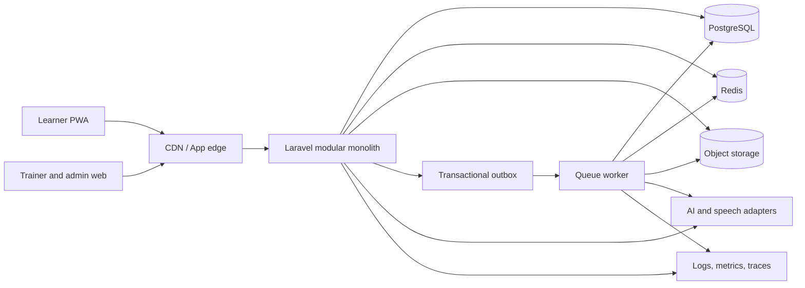

# Global English — Enterprise Product Master Plan

**Version:** 2.0  
**Status:** Proposed implementation baseline  
**Prepared:** 29 July 2026  
**Source reviewed:** [Global Spoken English App — Phase 1 Codex Handoff Plan](./global-spoken-english-phase1-codex-plan.md)

## 1. Executive decision

Build a mobile-first, Kannada-guided spoken-English learning platform for adults who need practical English for daily life, education, interviews, and work.

The first release will be:

- a Progressive Web App that works well on low-cost Android phones and unreliable networks;
- Kannada-first for explanations and navigation, with English used as the learning language;
- centred on actual speaking, not only audio consumption and multiple-choice quizzes;
- a Laravel modular monolith with a React and TypeScript client;
- enterprise-ready for institutions, cohorts, trainers, content governance, audit, and reporting;
- deterministic for scoring, attendance, mastery, and level unlocking;
- enhanced by a bounded AI Teacher, but never dependent on AI for core learning;
- launched first as an adult pilot so that child-consent and child-safety requirements are not handled casually.

The product promise is:

> Open the app, understand the task in Kannada, speak useful English within minutes, receive clear feedback, and always know the next small step.

## 2. Verdict on the source plan

The source plan is a useful feature handoff. It correctly prioritizes Kannada explanations, a modular monolith, provider-independent AI, realistic seed data, testing, and a daily habit.

It is not yet an enterprise implementation specification or a defensible spoken-English learning design. The following corrections are required before schema lock or application scaffolding.

| Gap in the source plan | Enterprise correction |
|---|---|
| “Spoken English” can be completed without the learner speaking | Every core lesson uses listen → understand → repeat/record → role-play → recall → feedback |
| Nineteen levels have rooms but no measurable proficiency outcomes | Versioned curriculum with observable “I can…” competencies, rubrics, prerequisites, and retention checks |
| Global `student`, `trainer`, and `admin` roles | Organization-scoped memberships, permissions, cohorts, enrollments, and tenant isolation |
| App engagement can silently become attendance | Separate learning engagement, course-day completion, and trainer-recorded class attendance |
| Kannada is represented as hard-coded strings and loose translations | Governed `kn-IN` content with source linkage, review, approval, publication, rollback, and glossary |
| PWA is named but offline behaviour is undefined | Cached lesson bundles, visible download/sync state, idempotent offline outbox, resumable media |
| Trainer/admin UI is optional | Minimum operator console for enrollment, content, review, notices, corrections, support, and reports |
| AI receives broad learner context and can become a generic chatbot | Approved-content grounding, minimum context, structured output, safety evaluation, cost limits, and deterministic fallback |
| Flat lesson and quiz schema | Immutable curriculum versions, reusable learning items, normalized choices, attempt snapshots, and objective evidence |
| Production controls are checklists | Explicit security baseline, SLOs, observability, backup restoration, incident response, CI/CD, and release gates |
| Accessibility is left until final QA | WCAG 2.2 AA is part of component and journey acceptance from the start |
| Placeholder citations have no bibliography | Replace them with decisions, acceptance criteria, and direct primary references |

## 3. Product strategy

### 3.1 Phase 1 learner

The initial production pilot targets Kannada-speaking adults aged 18 or older. The platform must not infer English ability, Kannada literacy, goals, or digital confidence from language or location.

Research and onboarding must account for at least four behavioural profiles:

1. A pre-A1 learner with limited English literacy.
2. A learner who understands school English but avoids speaking.
3. A job, interview, service, or workplace learner with situation-specific goals.
4. A low-connectivity or shared-device learner with limited privacy for recording.

Minors can be supported in a later controlled release only after guardian-consent, child-safety, retention, institution-role, and legal requirements have passed a separate release gate.

### 3.2 Product outcomes

The platform succeeds when learners can do more with spoken English, not merely when they open the app.

Primary learning outcomes:

- understand level-appropriate spoken English in practical situations;
- produce comprehensible phrases and short turns;
- take part in short conversations, including clarification and repair;
- retain useful language after a delay;
- transfer practised language to a new situation.

Primary product outcomes:

- the learner completes a first speaking turn without facilitator help;
- the learner returns consistently across a week;
- the learner understands what to do next;
- the trainer can identify who needs help and why;
- approved learning content can be safely published and rolled back;
- progress evidence remains accurate across retries, offline work, and content changes.

### 3.3 North-star and guardrail metrics

**North-star metric:** weekly learners who complete at least three meaningful speaking-practice sessions and one delayed review.

Learning metrics:

- can-do objectives mastered;
- speaking minutes and meaningful speaking turns;
- first-attempt versus retry improvement;
- seven-day retained mastery;
- listening and interaction performance;
- trainer-rated transfer task performance.

Product metrics:

- first-session speaking activation;
- day-7 and day-30 retained learners;
- weekly mission completion;
- offline completion and successful sync;
- time to first useful action;
- learner-reported clarity of Kannada guidance.

Guardrail metrics:

- cross-tenant access incidents;
- lost or duplicate attempts;
- AI critical-safety failures;
- AI feedback accuracy and helpfulness;
- incorrect absence or unlock decisions;
- accessibility blockers;
- support cases per 100 active learners;
- AI and media cost per active learner.

Streaks, logins, page views, quiz totals, and attendance are supporting metrics, not proof of learning.

## 4. Learning system

### 4.1 Curriculum model

Retain the requested public structure of Pre-Level 1, Pre-Level 2, and Levels 1–17, but define each level by outcomes before building its screens.

Every level requires:

- four to eight observable adult-life “I can…” outcomes;
- target scenarios and communication functions;
- listening, spoken production, and interaction evidence;
- useful phrases and vocabulary;
- grammar in use;
- pronunciation and intelligibility targets;
- prerequisite objectives;
- estimated learning time;
- formative practice and a summative transfer task;
- remediation and delayed-review rules.

The outcome framework may be informed by CEFR Pre-A1, A1, A2, and B1 descriptors, especially oral production, interaction, mediation, and phonological control. The product must not claim official CEFR certification or equivalence until independently validated.

### 4.2 Daily mission

A normal mission should take approximately 10–15 minutes:

1. **Goal in Kannada:** a short, audio-supported explanation of what the learner will be able to say.
2. **Model dialogue:** listen once for overall meaning and again for detail.
3. **Notice:** focus on three to five useful English chunks or one sound/rhythm feature.
4. **Repeat and record:** shadow the model, record, play back, and retry.
5. **Guided practice:** substitute names, places, times, or needs in the target pattern.
6. **Role-play:** complete a three-to-five-turn practical exchange.
7. **Personal response:** use the language with the learner’s own information.
8. **Recall and feedback:** answer a short knowledge check, receive one priority correction, and see the next action in Kannada.

Every core daily mission must contain learner speech. If the microphone is unavailable, the learner receives a transparent alternative practice path but is not falsely awarded spoken mastery.

### 4.3 Assessment model

Separate learning practice from formal checks:

- formative practice allows guided retries and records first, latest, and best evidence;
- summative checks use bounded attempts and a new scenario;
- delayed review checks retention after an interval;
- trainer review is available for borderline or flagged attempts;
- automated speech analysis is advisory until validated against trained human raters.

The speaking rubric covers:

- task completion;
- comprehensibility and intelligibility;
- fluency and pausing;
- useful vocabulary and chunks;
- grammar control appropriate to the objective;
- interaction, turn-taking, and repair.

Level unlocking is based on objective mastery and evidence, not only completion percentage. Unlock decisions are deterministic, versioned, explainable, and auditable.

### 4.4 Kannada-to-English teaching strategy

Kannada provides clarity and emotional safety; English exposure increases gradually inside practice.

Rules:

- explain new or difficult tasks in clear conversational Kannada;
- make important Kannada instructions playable as short human-reviewed audio;
- show English examples with correctly tagged Kannada explanations;
- provide an always-available Kannada help control;
- gradually introduce English-only practice zones according to demonstrated proficiency;
- make transliteration optional and learner-tested, never the pronunciation authority;
- maintain a bilingual educator-reviewed contrastive error bank;
- trigger transfer guidance from actual learner evidence, not stereotypes;
- prioritize intelligibility and successful communication, not imitation of a native accent.

### 4.5 Pilot curriculum scope

Phase 1 ships:

- shells and outcome summaries for all requested levels;
- one complete, publishable Pre-Level 1 pathway;
- 14–30 days of reviewed missions;
- baseline placement and end-unit transfer tasks;
- review scheduling and one complete unlock path;
- representative scenarios chosen through learner research.

The product must not advertise an unfinished level as available.

## 5. Learner experience

### 5.1 Mobile navigation

Use no more than four bottom-navigation destinations:

- **Home**
- **Learn**
- **Teacher**
- **More**

The internal backend module structure must not become learner navigation.

### 5.2 Home

Home has one dominant action:

- today’s mission;
- estimated time and download size;
- progress such as “1 of 3 steps complete”;
- one large Continue button;
- connection, offline, or sync state;
- one urgent notice when applicable.

Level progress, weekly consistency, and attendance are secondary. Dense KPI dashboards are reserved for trainers and administrators.

### 5.3 Core screens

| Screen | Required experience |
|---|---|
| Sign in | Organization code + mobile number + six-digit OTP; admission ID + one-time setup code for learners without a personal phone; Kannada-first recovery |
| First use | Language and accessibility preferences, audio-led walkthrough, goal selection, short placement, recording consent |
| Lesson | Large audio controls, replay, 0.75×/1× speed, transcript, Kannada explanation, download size, resume position |
| Speaking | Listen to model, record, play back, retry, permission explanation, quiet/no-mic alternative |
| Quiz | One question per screen, progress indicator, large answer targets, autosave, no forced timer |
| Result | Can-do feedback, mistake explanation in Kannada, English model, retry, one next action |
| Levels | Current and next level first; full course map behind a secondary action; exact unlock requirements |
| Progress | Can-do mastery, speaking practice, review due, and recent improvement—separate from attendance |
| Attendance | Distinct class attendance and learning-day completion with denominator and pending-sync state |
| AI Teacher | Approved Kannada quick actions first, free input second, clear AI label, report and privacy controls |
| Notices | Urgent/unread state, cached critical notices, read-aloud option, acknowledgement only when required |
| Help & Sync | Unsynced count, retry, Kannada explanation, support reference, contact-trainer action |

### 5.4 Offline and low-bandwidth contract

After a learner downloads a mission, the following work offline:

- app shell and Kannada UI bundle;
- today’s lesson, transcript, quiz, and model audio;
- recording and local playback;
- curated teacher help for the mission;
- latest essential notices;
- local progress and submission queue.

Technical behaviour:

- every client event has a UUID;
- mutating APIs support idempotency;
- IndexedDB holds a versioned outbox;
- sync states are visible: online, offline, saved on phone, syncing, failed;
- retry uses bounded backoff;
- audio supports a low-data variant, range requests, and resumable playback;
- legitimate offline work cannot create an incorrect absence;
- sensitive AI chat is not cached offline by default;
- conflict rules favour immutable attempts and server-confirmed publishing state.

### 5.5 Accessibility

Target WCAG 2.2 AA from the first component:

- accurate transcripts for all learning audio;
- keyboard access and visible focus;
- semantic structure, skip links, and announced errors;
- no status communicated by colour alone;
- 200–400% text reflow and zoom support;
- reduced motion and no forced timers;
- accessible audio and recording controls;
- large touch targets;
- `lang="kn-IN"` and `lang="en"` on mixed-language spans;
- a validated Kannada font stack, Unicode normalization, comfortable line height, and robust wrapping;
- manual TalkBack testing on representative Android hardware and VoiceOver testing for critical journeys.

Dark mode is lower priority than offline use, readability, audio guidance, and accessibility.

## 6. Operator experience

The platform cannot be operated safely through seeders and raw POST endpoints. Phase 1 includes a minimum web console.

### 6.1 Trainer workspace

- cohort and learner overview;
- today’s completion and learners needing help;
- failed sync and incomplete work;
- selected speaking submissions awaiting feedback;
- class attendance and correction with reason;
- notice creation and cohort targeting;
- learner history and support notes;
- CSV export subject to permission and audit.

### 6.2 Content studio

A learning bundle moves through:

`Draft → Linguistic review → Academic approval → Scheduled → Published → Retired`

The studio supports:

- objective and prerequisite selection;
- English model content;
- Kannada explanation and audio;
- source provenance, usage rights, voice-talent consent, and license metadata;
- transcript and accessibility validation;
- model dialogue and speaking task;
- quiz/assessment items with rationale;
- low-data asset generation;
- phone-width preview;
- named translator and independent reviewer;
- scheduling by curriculum/cohort;
- immutable publication version and rollback.

Raw machine-translated or unreviewed Kannada cannot be published.

### 6.3 Organization administration

- organization, branch, cohort, and academic calendar;
- enrollment and trainer assignment;
- role and permission management;
- learner account/PIN reset and session revocation;
- organization timezone and learning-day policy;
- integration and feature settings;
- audit, retention, export, and deletion workflows.

## 7. Phase 1 scope

### 7.1 Must ship

- organization, cohort, enrollment, and scoped permissions;
- learner authentication, onboarding, preferences, consent, and placement;
- Kannada-first mobile learner shell;
- one complete daily speaking vertical slice;
- 14–30 days of governed Pre-Level 1 content;
- recording, playback, retry, and optional upload;
- formative quiz and a speaking transfer task;
- deterministic objective mastery and one level unlock;
- learning engagement and separate class attendance;
- level map and honest availability states;
- notices and essential offline notice cache;
- bounded, feature-flagged AI Teacher;
- minimum trainer, content, translation-review, and organization console;
- offline mission bundle and idempotent sync;
- product, learning, safety, cost, and operational analytics;
- accessibility, security, backup, monitoring, and support readiness.

### 7.2 Explicitly deferred

- native iOS or Android apps;
- payments, subscriptions, and marketplace features;
- live classes and real-time group video;
- an open social feed or learner-to-learner direct messaging;
- fully automated high-stakes pronunciation grading;
- AI-controlled scores, attendance, or progression;
- unrestricted general-purpose AI chat;
- complete authored content for all nineteen levels;
- formal CEFR certification claims;
- minors until the child-data release gate passes.

## 8. Technical architecture

### 8.1 Stack decision

Use one repository and one product architecture:

- **Backend:** Laravel 13 on PHP 8.4, exposed as `/api/v1`.
- **Frontend:** React 19.2, TypeScript, Vite, and a service-worker-based PWA.
- **Authentication:** Laravel Sanctum with same-origin, Secure, HttpOnly cookie sessions; organization code + mobile OTP for normal learners; admission ID + one-time setup code where a personal phone is unavailable; MFA for privileged roles; no browser-stored bearer tokens.
- **Database:** PostgreSQL 18 as the system of record.
- **Cache/queue/rate limits:** Redis; loss of Redis must not corrupt canonical records.
- **Media:** S3-compatible object storage with signed access and CDN delivery.
- **Background work:** Laravel queue workers and scheduler.
- **Contracts:** OpenAPI 3.1, generated client types, and contract validation.
- **Deployment:** containerized stateless web/API, worker, and scheduler processes using managed database, cache, object storage, secrets, and observability services.

Versions are pinned in lockfiles during scaffolding and updated under automated dependency policy.

### 8.2 Modular monolith

Modules:

- Platform: Tenancy, Identity & Access, Localization, Audit, Outbox.
- Learning: Learners, Goals, Cohorts & Enrollments, Curriculum, Content.
- Delivery: Daily Missions, Media, Speech Practice, Assessments.
- Records: Engagement, Attendance, Mastery, Progression.
- Communications: Notices, targeting, acknowledgements.
- AI Teacher: context policy, grounding, prompts, provider adapters, safety, evaluation.
- Reporting: read models and exports; never canonical learning writes.

Each module owns its tables and writes. Cross-module changes use application commands. Asynchronous side effects use a transactional outbox; a message broker is not needed for Phase 1.



### 8.3 Repository shape

```text
/
├── apps/
│   ├── api/                 Laravel application
│   └── web/                 React PWA for learners and operators
├── packages/
│   ├── contracts/           Generated API types and schemas
│   ├── design-system/       Accessible bilingual components and tokens
│   └── localization/        UI message catalogues and glossary exports
├── infra/                   Deployment and environment definitions
├── docs/
│   ├── adr/                 Architecture decision records
│   ├── api/                 OpenAPI and contract guidance
│   ├── curriculum/          Outcomes, rubrics, and content standards
│   ├── operations/          Runbooks, SLOs, incident and restore guides
│   └── privacy/             Data inventory, consent, retention, deletion
└── tests/
    └── e2e/                 Cross-application critical journeys
```

## 9. API and consistency rules

- Version APIs under `/api/v1`.
- Derive organization context from authenticated membership, never from an untrusted request field.
- Use a stable problem-detail error contract with a user-safe localized message key.
- Require idempotency keys for offline submissions, attempt finalization, attendance overrides, and AI requests that create records.
- Use cursor pagination for histories and notices.
- Use optimistic concurrency on content editing and other competing operator writes.
- Use ISO 8601 timestamps in UTC; calculate local learning days using the organization timezone.
- Return locale-neutral contracts such as `guidance: { locale, text, audio_asset }`, never fields named `kannada_hint`.
- Start and submit assessment attempts separately.
- Never send correct answers before submission.
- Snapshot published item versions into attempts so later edits do not change history.
- Generate and validate frontend types from OpenAPI.
- Document authorization, rate limits, deprecation, and caching per endpoint.

The learner must not call an endpoint that decides whether they deserve an unlock. Completion commands trigger a server-side progression decision.

## 10. Domain model

Use ULIDs consistently for public identifiers. Every tenant-owned record includes `organization_id`, tenant-aware indexes, and composite uniqueness where applicable.

### 10.1 Platform and people

- `organizations`, `branches`
- `users`, `user_identities`, `sessions`
- `memberships`, `roles`, `permissions`, `membership_roles`
- `learner_profiles`, `trainer_profiles`, `learner_goals`
- `cohorts`, `cohort_trainers`, `enrollments`
- `academic_calendars`, `scheduled_learning_days`
- `consents`, `privacy_requests`, `support_cases`

Roles belong to memberships, not users. One person may have different roles in different organizations.

### 10.2 Curriculum and content

- `programs`, `curriculum_versions`
- `levels`, `modules`, `learning_objectives`, `objective_prerequisites`
- `lessons`, `learning_items`, `lesson_objectives`
- `content_revisions`, `localized_variants`, `translation_reviews`
- `glossary_terms`, `media_assets`, `media_variants`
- `publication_workflows`, `publication_events`

Enrollments are pinned to a curriculum version. Published versions are immutable.

### 10.3 Delivery and evidence

- `daily_missions`, `mission_items`, `mission_assignments`
- `learner_attempts`, `item_responses`, `completion_events`
- `speech_tasks`, `speech_attempts`, `recording_assets`
- `assessment_definitions`, `assessment_items`, `assessment_options`
- `assessment_attempts`, `assessment_responses`
- `rubrics`, `rubric_criteria`, `rubric_scores`
- `mastery_states`, `review_schedules`, `unlock_decisions`

Choices are normalized rows, not `option_a`, `option_b`, and similar columns. Derived percentages are read models; immutable evidence is canonical.

### 10.4 Engagement, attendance, communication, and AI

- `learning_day_records`, `engagement_events`
- `class_attendance_records`, `attendance_corrections`
- `notices`, `notice_localizations`, `notice_audiences`, `notice_acknowledgements`
- `ai_sessions`, `ai_interactions`, `prompt_versions`, `model_runs`
- `ai_safety_events`, `ai_feedback_reports`, `ai_cost_ledger`
- `audit_events`, `outbox_events`, `processed_events`

Attendance records include policy/rule version, evidence, source, actor, override reason, and local date. AI logs are redacted and retained according to policy.

## 11. Localization and content governance

Use BCP 47 locale codes:

- UI and explanation default: `kn-IN`
- learning language: `en-IN`
- optional operator locale: `en-IN`

Store separate learner preferences for:

- `ui_locale`
- `explanation_locale`
- `learning_locale`
- audio-instruction preference
- transliteration preference
- accessibility preferences

Rules:

- UI message catalogues and curriculum content have separate lifecycles.
- Learner-critical content cannot publish without an approved Kannada variant.
- Each localized variant links to source revision/hash, translator, reviewer, approval time, and fallback state.
- Source edits mark affected translations stale.
- Translators cannot approve their own work.
- The glossary fixes product terms and preferred plain-language Kannada.
- Mixed-language rendering carries correct language metadata for assistive technology.
- Fallback is explicit and observable; it must not silently expose an incomprehensible learner screen.

## 12. AI Teacher

### 12.1 Product boundary

The AI Teacher is a guided course assistant, not an unrestricted chatbot and not a source of record.

It may:

- explain an approved lesson in Kannada;
- provide an English example;
- run a bounded role-play;
- give one prioritized, level-appropriate correction;
- suggest a retry or next approved activity;
- summarize progress using allowlisted facts.

It may not:

- change attendance, scores, mastery, or unlocks;
- invent curriculum requirements;
- diagnose medical, psychological, or learning conditions;
- expose another learner’s information;
- use broad personal context merely because it exists;
- block the core lesson when the provider is unavailable.

### 12.2 Technical contract

- retrieve only published curriculum content for the active objective;
- allowlist context per AI mode;
- delimit learner, trainer, and content text as untrusted input;
- version the system prompt, mode prompt, model, provider, and evaluation set;
- request structured output such as Kannada explanation, English example, feedback, next action, and safety status;
- validate output schema and language/script;
- redact unnecessary PII before provider calls and logs;
- stream responses where helpful;
- enforce per-learner and per-organization rate and spend caps;
- provide a curated Kannada fallback within two seconds when AI is unavailable;
- let learners report an answer and request human help;
- place all AI features behind flags and staged rollout.

### 12.3 Release evaluation

Maintain a locked evaluation set covering:

- simple Kannada clarity;
- mixed Kannada-English rendering;
- curriculum correctness;
- level appropriateness;
- common learner errors;
- prompt injection;
- harassment, shame, and unsafe motivation;
- fabricated scores or requirements;
- provider failure and timeout;
- noisy speech and unsupported scoring.

Human bilingual reviewers must judge feedback accuracy, usefulness, and tone. Any critical state-mutation claim, privacy leak, dangerous response, or invented curriculum rule blocks release.

## 13. Privacy, security, and responsible data

The system must be designed for India’s Digital Personal Data Protection framework and validated by qualified legal counsel before production. The pilot adult-only assumption does not remove consent, notice, purpose limitation, security, access, correction, erasure, retention, and grievance obligations.

Minimum controls:

- data inventory, purpose, legal basis/consent, retention, and deletion policy for every sensitive field;
- separate explicit Kannada consent for recording and AI processing;
- learner review and deletion controls for recordings where policy permits;
- no raw voice retention by default beyond the declared learning need;
- organization-scoped authorization policies and cross-tenant tests;
- MFA for privileged roles;
- session listing and revocation;
- CSRF, CSP, HSTS, secure-cookie, CORS, and rate-limit policy;
- encryption in transit and managed encryption at rest;
- secret management and rotation;
- signed media URLs and strict upload MIME, size, and malware checks;
- append-only privileged-action audit;
- dependency, secret, static-analysis, and container scanning;
- privacy-safe logs with correlation IDs;
- vendor data-processing review for AI, speech, messaging, analytics, and hosting;
- incident detection, containment, notification, and evidence runbooks;
- tested data export, correction, account closure, and erasure workflows.

Use OWASP ASVS 5.0 Level 2 as the application-security verification target where applicable.

## 14. Reliability, performance, and operations

### 14.1 Initial service objectives

| Area | Pilot target |
|---|---|
| Core service availability | 99.9% monthly, excluding declared maintenance |
| Non-AI API latency | p95 ≤ 500 ms for normal reads and writes under forecast load |
| Dashboard API | p95 ≤ 800 ms before network transfer |
| AI interaction | p95 complete response ≤ 15 s with streaming; fallback ≤ 2 s after known failure |
| Submission integrity | No acknowledged attempt, score, or offline event may be lost |
| Recovery point objective | ≤ 15 minutes |
| Recovery time objective | ≤ 2 hours |
| Capacity validation | Load test at 2× the forecast pilot peak |

Targets are confirmed against a documented launch forecast during architecture freeze.

### 14.2 Operational controls

- structured logs, metrics, traces, and correlation IDs;
- dashboards for latency, errors, saturation, queue age, failed jobs, sync failures, AI latency/safety/fallback/cost, and integrity reconciliation;
- dependency timeouts, bounded retry with jitter, circuit breakers, and dead-letter handling;
- idempotent workers and replayable outbox consumers;
- PostgreSQL point-in-time recovery and encrypted backups;
- restore drill before pilot and at least quarterly thereafter;
- stateless horizontal application scaling and database connection pooling;
- feature flags, canary/staged rollout, immutable artifacts, and one-command rollback;
- runbooks for AI outage, media outage, queue backlog, database degradation, sync incidents, privacy requests, and security incidents.

## 15. Quality strategy

### 15.1 Automated testing

- backend unit tests for policies, scoring, mastery, schedules, attendance, and content publication;
- database integration tests with real PostgreSQL behaviour;
- tenant-isolation tests for every tenant-owned resource;
- duplicate, concurrent, replay, timezone, and offline-sync tests;
- OpenAPI contract and compatibility tests;
- frontend component and interaction tests;
- PWA cache migration and outbox recovery tests;
- end-to-end tests for learner and operator golden paths;
- accessibility automation plus required manual assistive-technology testing;
- AI provider contract tests and locked evaluation suite;
- migration-forward, rollback/mitigation, backup, and restore tests;
- load, soak, and dependency-failure tests before pilot.

### 15.2 CI/CD gates

Every change must pass:

- formatting and linting;
- PHP and TypeScript static analysis;
- unit, integration, contract, and affected end-to-end tests;
- locale-key and Kannada-publication validation;
- dependency, license, secret, SAST, and artifact scanning;
- migration safety checks;
- production build and provenance generation.

Production promotion additionally requires:

- staging evidence;
- approved change and rollback plan;
- no unresolved critical or high security finding;
- no accessibility blocker on critical journeys;
- reviewed migration and feature-flag state.

## 16. Delivery plan and checkpoints

Work proceeds by gated vertical slices, not by creating every table and screen first.

### Step 0 — Product and architecture freeze

**Status:** this master plan is the proposed output.

Deliver:

- interviews and observed-task research with 15–20 representative adults across the defined profiles;
- validated learner assumptions and research evidence;
- first 10 target communication situations;
- initial Pre-Level 1 “I can…” map;
- architecture decision records;
- data classification and threat-model outline;
- launch forecast, budget boundary, SLO, RPO, and RTO;
- adult-only pilot decision;
- wireflow for the first daily mission.

Exit gate:

- product, curriculum, architecture, privacy, and pilot assumptions are internally consistent;
- no unresolved decision can materially change the foundation schema.

### Step 1 — Secure bilingual foundation

Deliver:

- repository and monorepo scaffold;
- Laravel API, React PWA, PostgreSQL, Redis, and object-storage adapters;
- same-origin authentication skeleton;
- organization, membership, permission, cohort, and enrollment foundation;
- OpenAPI baseline and generated frontend types;
- `kn-IN`/`en-IN` localization bootstrap and accessible design tokens;
- CI pipeline, health/readiness endpoints, structured logging, and test baselines;
- ADRs, environment examples, and local/cloud developer workflow.

Exit gate:

- CI is green;
- tenant-isolation tests pass;
- Kannada renders correctly in the app shell;
- no browser bearer token is used;
- a deployable staging skeleton is observable and rollback-safe.

### Step 2 — Deterministic daily-speaking vertical slice

Deliver:

- sign-in and learner onboarding;
- one published mission with audio, transcript, Kannada guidance, recording/playback, retry, quiz, and result;
- idempotent offline outbox and sync state;
- immutable attempt evidence;
- deterministic engagement, mastery, progress, and dashboard read model;
- no-AI completion path.

Exit gate:

- login → download → learn → speak → quiz → sync → progress works online and offline;
- duplicate/concurrent submission tests pass;
- no lost acknowledged data;
- a representative learner can complete the speaking turn without facilitator help.

### Step 3 — Curriculum, assessment, and governed content

Deliver:

- versioned program, curriculum, level, objective, lesson, assessment, and rubric models;
- placement and delayed-review flow;
- 14–30 days of approved Pre-Level 1 content;
- content studio and Kannada review workflow;
- learner progress by can-do objective;
- one validated transfer task and one level unlock.

Exit gate:

- all pilot content has an objective, approved Kannada, transcript, model audio, speaking task, feedback path, and review schedule;
- published content is immutable and rollback works;
- enrolled learners remain pinned to their curriculum version.

### Step 4 — Bounded AI Teacher beta

Deliver:

- context allowlist, approved-content grounding, prompt versions, provider adapter, structured output, safety checks, fallback, reporting, cost ledger, and evaluation harness;
- guided quick actions and bounded role-play;
- optional feedback for selected speech/text tasks.

Exit gate:

- AI cannot mutate canonical learning records;
- Kannada evaluation meets the agreed accuracy/helpfulness bar;
- zero critical failures in the locked safety set;
- spend and rate caps work;
- provider outage does not block learning.

### Step 5 — Enterprise operator workflows

Deliver:

- trainer dashboard, learner support queue, attendance correction, speaking review, and exports;
- organization administration, account recovery, academic calendar, roles, and audit;
- notice targeting, translation review, scheduling, and acknowledgement;
- operational analytics and support diagnostics.

Exit gate:

- an institution can enroll, teach, support, report, correct, and audit without direct database access;
- every privileged action is authorized and auditable.

### Step 6 — Production pilot hardening

Deliver:

- WCAG 2.2 AA critical-journey evidence;
- load, soak, security, privacy, backup-restore, and failure testing;
- monitoring, alerts, incident and support runbooks;
- staged deployment and rollback rehearsal;
- pilot analytics and feedback process.

Exit gate:

- no unresolved severity-1/severity-2 defect or data-integrity discrepancy;
- no unresolved critical/high security issue;
- tenant isolation and restore objectives are proven;
- low-end Android usability and Kannada comprehension are signed off;
- support and privacy workflows are operational.

### Step 7 — Pilot learning validation

Run the adult pilot, compare baseline and transfer-task evidence, audit AI feedback, identify subgroup failures, and revise the curriculum and product.

Initial pilot thresholds, to be confirmed at Step 0:

| Measure | Initial gate |
|---|---|
| First speaking turn | At least 90% of representative learners complete it without facilitator help |
| Novel transfer task | At least 80% of pathway completers demonstrate the published can-do outcome |
| Seven-day retention | Median retained mastery of at least 80% |
| Human-rated AI feedback | At least 90% accurate, level-appropriate, and actionable |
| Critical AI failures | Zero in the locked safety evaluation |
| Double-rated speaking sample | Weighted κ ≥ 0.70 or ICC ≥ 0.75 |
| Offline sync | At least 99.5% of valid queued submissions confirmed within 24 hours of reconnect |

Scale beyond Pre-Level 1 only after those confirmed gates pass and:

- learners can independently complete the journey;
- automated feedback shows no material false-fail gap by device, noise condition, or reviewed learner subgroup;
- support load and unit economics are acceptable;
- content production and review throughput is sustainable.

## 17. Step 1 implementation backlog

The next coding checkpoint will execute only this backlog:

1. Initialize Git, repository conventions, ownership, and environment templates.
2. Create `apps/api` with Laravel 13, PHP 8.4, PostgreSQL, Redis, health endpoints, and test configuration.
3. Create `apps/web` with React 19.2, TypeScript, PWA shell, routing, testing, and accessibility baseline.
4. Create the OpenAPI document, problem contract, generated client package, and CI contract validation.
5. Implement organization-scoped identity skeleton and secure same-origin session flow.
6. Implement locale bootstrap for `kn-IN` and `en-IN`, mixed-language semantics, font loading, and glossary seed.
7. Implement the accessible application shell with one mobile Home action and operator-shell placeholder.
8. Add logging, correlation IDs, audit/outbox foundations, and readiness checks.
9. Add CI for format, lint, static analysis, tests, builds, secrets, and dependency checks.
10. Add ADRs for architecture, tenancy, authentication, locales, adult pilot, attendance semantics, curriculum versioning, AI authority, and data retention.

No lesson, AI, or reporting feature will be expanded until the Step 1 exit gate passes.

## 18. Architecture decisions accepted by default

| Decision | Default |
|---|---|
| Initial audience | Kannada-speaking adults, 18+ |
| Delivery surface | Mobile-first PWA; desktop operator web |
| Backend/frontend | Laravel 13 API + React 19.2 TypeScript |
| Architecture | Modular monolith |
| Deployment | Same-origin web/API; separate worker and scheduler processes |
| Tenancy | Shared schema with mandatory organization scoping |
| Authentication | Organization code + mobile OTP; admission ID setup fallback; secure cookie sessions; privileged MFA |
| Database | PostgreSQL 18 |
| Localization | `kn-IN` explanation/UI, `en-IN` learning |
| Curriculum | Immutable versions; enrollment pinned to a version |
| Progression | Deterministic and evidence-based |
| Attendance | Class attendance separate from learning engagement |
| Voice | Consent-based; minimal retention; automated scores advisory |
| AI | Grounded, feature-flagged, provider-adapted, never authoritative |
| Offline | Core daily mission works after download |
| Accessibility | WCAG 2.2 AA target |
| Security | OWASP ASVS 5.0 Level 2 target where applicable |

## 19. Phase 1 definition of done

Phase 1 is complete only when:

- an adult learner can sign in and understand the first action in Kannada;
- the learner can complete a real speaking mission online and offline;
- acknowledged work survives retry, duplicate submission, reconnect, and deployment;
- the learner sees can-do progress rather than only completion percentages;
- class attendance and learning engagement cannot be confused;
- one complete level has reviewed content, valid evidence, remediation, delayed review, and deterministic unlock;
- trainer and content teams can operate the pilot without engineering or database access;
- Kannada content is reviewed, versioned, publishable, and rollback-safe;
- AI is optional, bounded, evaluated, cost-controlled, private, and unable to modify canonical records;
- tenant isolation, authorization, accessibility, security, monitoring, restore, incident, and support gates pass;
- product analytics distinguish usage from demonstrated learning;
- the app does not market unavailable content, automated scoring, CEFR certification, or unsupported outcomes.

## 20. Primary references

- [Council of Europe — CEFR Companion Volume](https://www.coe.int/en/web/common-european-framework-reference-languages/cefr-companion-volume-and-its-language-versions)
- [W3C — Web Content Accessibility Guidelines 2.2](https://www.w3.org/TR/WCAG22/)
- [OWASP — Application Security Verification Standard](https://owasp.org/www-project-application-security-verification-standard/)
- [MeitY — Digital Personal Data Protection Act, 2023](https://www.meity.gov.in/static/uploads/2024/02/Digital-Personal-Data-Protection-Act-2023.pdf)
- [MeitY — Digital Personal Data Protection Rules, 2025](https://www.meity.gov.in/documents/act-and-policies/digital-personal-data-protection-rules-2025-gDOxUjMtQWa)
- [Laravel 13 release and support policy](https://laravel.com/docs/13.x/releases)
- [React current versions](https://react.dev/versions)
- [PostgreSQL versioning and support policy](https://www.postgresql.org/support/versioning/)
